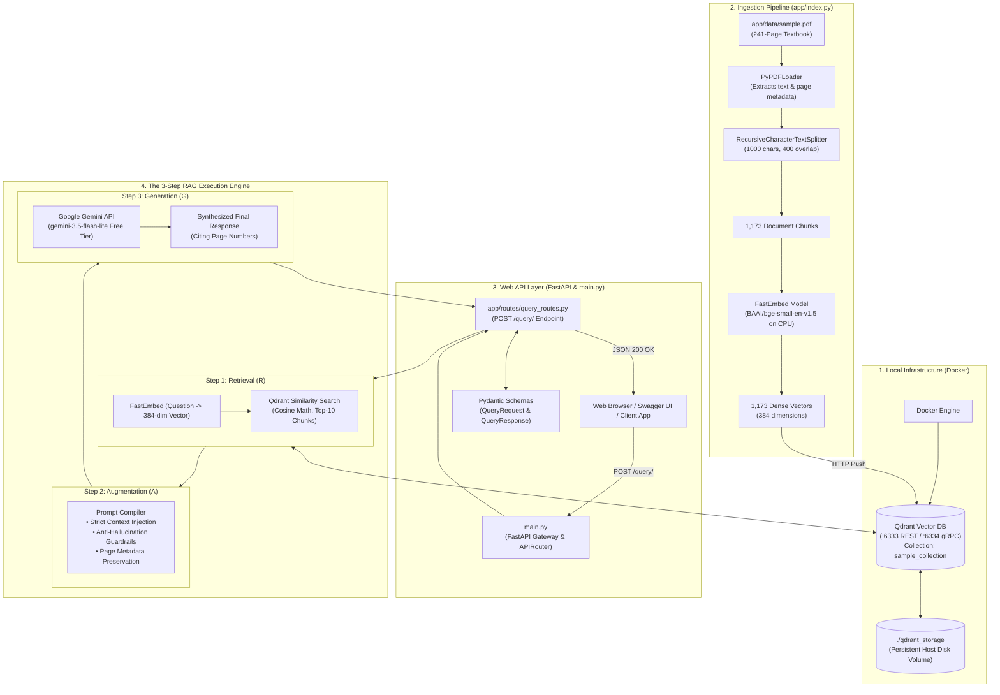

# 🏛️ Master Architecture & End-to-End Execution Flow

> **The Single Source of Truth for the Entire RAG Project**  
> Covers: High-level System Architecture, Component Relationships, End-to-End Execution Sequence, and Step-by-Step Running Instructions.

---

## 🗺️ 1. Complete System Architecture



---

## 🔄 2. End-to-End Execution Flow (Chronological Sequence)

When a user opens the browser and asks a question, here is the exact microsecond-by-microsecond sequence of events:

```mermaid
sequenceDiagram
    autonumber
    actor User as User / Swagger UI
    participant FastAPI as main.py / FastAPI
    participant Route as query_routes.py
    participant FastEmbed as FastEmbed (Local CPU)
    participant Qdrant as Qdrant Vector DB (:6333)
    participant Gemini as Google Gemini API

    User->>FastAPI: HTTP POST /query/ {"question": "What is HTTP?"}
    FastAPI->>Route: Dispatches to query(request: QueryRequest)
    Note over Route: Validates input string is not empty
    
    rect rgb(20, 35, 60)
        Note over Route,Qdrant: PHASE 1: RETRIEVAL (R)
        Route->>FastEmbed: Embed query string "What is HTTP?"
        FastEmbed-->>Route: Returns 384-dimensional dense vector
        Route->>Qdrant: similarity_search_with_score(vector, k=10)
        Qdrant-->>Route: Returns top-10 chunks (Page 205: 0.6131, Page 144: 0.6611)
    end

    rect rgb(30, 45, 30)
        Note over Route: PHASE 2: AUGMENTATION (A)
        Route->>Route: Formats context strings: "[Page 205] Glossary...", "[Page 144] HTTP/HTTPS..."
        Route->>Route: Injects into System Prompt with Anti-Hallucination rules
    end

    rect rgb(50, 30, 45)
        Note over Route,Gemini: PHASE 3: GENERATION (G)
        Route->>Gemini: generate_content(model="gemini-3.5-flash-lite", contents=prompt)
        Gemini-->>Route: "Based on context, HTTP stands for Hypertext Transfer Protocol (Page 205)..."
    end

    Route-->>FastAPI: Returns QueryResponse Pydantic model
    FastAPI-->>User: HTTP 200 OK JSON { question, answer, sources: [Page 205, Page 144] }
```



---

## 🗺️ 3. Component Interaction Map (How Every File Connects)

| Project File | Talks To | Data It Passes | Purpose |
| :--- | :--- | :--- | :--- |
| [`docker-compose.yml`](../docker-compose.yml) | Docker Daemon | Port `6333`, volume `./qdrant_storage` | Boots the Qdrant database engine |
| [`.env`](../.env) | Python `os.environ` | `GEMINI_API_KEY` | Provides secrets safely without hardcoding in Git |
| [`app/data/sample.pdf`](../app/data/sample.pdf) | `app/index.py` | Raw binary PDF bytes | The private knowledge source (241 pages) |
| [`app/index.py`](../app/index.py) | Qdrant (`:6333`) | 1,173 chunks & 384-dim vectors | Ingestion pipeline (runs once to populate Qdrant) |
| [`app/query.py`](../app/query.py) | Qdrant (`:6333`) | Query string | Local CLI diagnostic tool to verify vector search |
| [`main.py`](../main.py) | `app/routes/query_routes.py` | HTTP Requests | App gateway; mounts modular route blueprints |
| [`app/routes/query_routes.py`](../app/routes/query_routes.py) | FastEmbed, Qdrant, Gemini | Chunks, Prompts, Final Answer | The core production RAG endpoint |

---

## 🚀 4. How to Execute the Entire Project (From Zero to Running)

Here is the master step-by-step execution protocol:

### Step 1: Start the Vector Database
Open PowerShell in the project directory:
```powershell
cd C:\Users\ADMIN\Documents\hemant-python\RAG-learning
docker compose up -d
```
* **Verify:** Check container status with `docker ps`
* **Dashboard:** Open `http://localhost:6333/dashboard` in your browser.

---

### Step 2: Index Your PDF Document
*(Run this whenever you add a new PDF or change `chunk_size`)*
```powershell
python -m app.index
```
* **Expected Output:**
  ```text
  Vector store created and documents embedded successfully.
  ```
* **What happened:** 241 pages were split into 1,173 chunks and stored in Qdrant with 384 dimensions.

---

### Step 3: (Optional) Quick Diagnostic Verification in Terminal
Test that Qdrant vector retrieval works before touching the web server:
```powershell
python -m app.query "What is HTTP?"
```
* **Expected Output:** Prints the top 5 chunks with similarity scores (`0.6611`) and page numbers directly in PowerShell.

---

### Step 4: Start the FastAPI Web Server
```powershell
fastapi dev
```
*(Or if running from root: `fastapi dev RAG-learning/main.py`)*

* **Expected Output:**
  ```text
    FastAPI running on http://127.0.0.1:8000
    Documentation at http://127.0.0.1:8000/docs
  ```

---

### Step 5: Test & Query in Your Browser

1. Open your browser to: **`http://127.0.0.1:8000/docs`**
2. Click on **`POST /query/`** &rarr; **`Try it out`**.
3. In the Request body, enter:
   ```json
   {
     "question": "What is HTTP?"
   }
   ```
4. Click **`Execute`**.
5. **View Response:**
   ```json
   {
     "question": "What is HTTP?",
     "answer": "Based on the provided context, HTTP stands for Hypertext Transfer Protocol (Page 205). It is frequently employed for client/server web-based interactions and offers a stateless communication mechanism appropriate for a variety of uses (Page 144).",
     "sources": [
       { "page": 205, "similarity_score": 0.6131, "content": "Glossary\n● HTTP: Hypertext Transfer Protocol..." },
       { "page": 144, "similarity_score": 0.6611, "content": "a. HTTP/HTTPS: Frequently employed for..." }
     ]
   }
   ```

---

## 🎤 5. The 60-Second Senior Interview Elevator Pitch

If an interviewer says: *"Tell me about the architecture of your RAG project"*, here is your exact 60-second answer:

> *"I engineered an end-to-end, decoupled RAG pipeline that operates 100% locally for vector ingestion and retrieval, combined with Google Gemini for zero-cost generation.*  
> 
> *For infrastructure, I run Qdrant inside a Docker container with host-mounted volume persistence.*  
> 
> *During ingestion, a 241-page textbook is parsed using PyPDFLoader, chunked via RecursiveCharacterTextSplitter with a 1000-character size and 400-character sliding window to maintain semantic continuity, and embedded locally using FastEmbed into 384-dimensional vectors.*  
> 
> *At runtime, our FastAPI ASGI backend receives user questions, embeds them using the identical FastEmbed model, and executes cosine similarity searches in Qdrant with k=10 to eliminate glossary dilution.*  
> 
> *Finally, the retrieved context is compiled into a strictly grounded, anti-hallucination prompt and passed to Google Gemini's gemini-3.5-flash-lite, which synthesizes factual answers citing exact page numbers with sub-second latency."*
