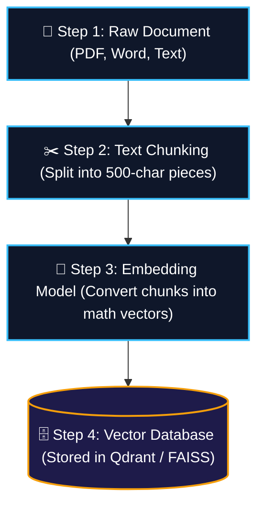
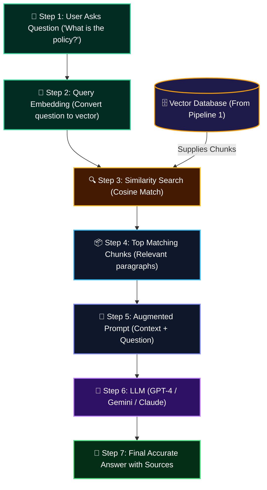

# 🧠 RAG (Retrieval-Augmented Generation) Fundamentals & Interview Prep

> **Location:** [RAG-learning](../README.md)  
> **Topic:** Core RAG architecture, Open-Book analogy, Indexing vs Querying pipelines, Vector Embeddings, and Senior Interview Q&A.

---

## 💡 1. What is RAG?

**RAG (Retrieval-Augmented Generation)** is an AI architectural framework that combines an external **Information Retrieval** system with a **Generative Large Language Model (LLM)**.

Instead of relying solely on the static knowledge the LLM learned during training, RAG dynamically pulls relevant facts from your private, proprietary, or real-time documents and feeds them to the LLM as reference context.

---

## 🎒 2. The Golden Analogy: Open-Book vs Closed-Book Exam

```
┌────────────────────────────────────────────────────────────────────────┐
│  1. LLM ALONE (Without RAG) = CLOSED-BOOK EXAM                         │
│                                                                        │
│  • The model studied public internet data months ago (training cutoff).│
│  • Has NO knowledge of your private company files, PDFs, or internal   │
│    databases.                                                          │
│  • Result: When asked an unknown fact, it guesses or HALLUCINATES      │
│    (confidently provides factually incorrect information).             │
└────────────────────────────────────────────────────────────────────────┘

                                   VS

┌────────────────────────────────────────────────────────────────────────┐
│  2. LLM WITH RAG = OPEN-BOOK EXAM                                      │
│                                                                        │
│  • You place YOUR specific documents directly on the student's desk!   │
│  • Step 1 (Retrieval): System finds the exact 2 or 3 relevant pages.   │
│  • Step 2 (Augmentation): It attaches those pages into the prompt.     │
│  • Step 3 (Generation): LLM reads the context and writes a 100%        │
│    accurate, factual answer backed by source citations.                │
└────────────────────────────────────────────────────────────────────────┘
```

---

## ⚖️ 3. RAG vs Fine-Tuning vs Prompt Engineering (Comparison Matrix)

| Dimension | **Prompt Engineering** | **RAG (Retrieval-Augmented Generation)** | **Fine-Tuning** |
| :--- | :--- | :--- | :--- |
| **How it works** | Rephrasing or structuring the text prompt. | Dynamically retrieving external documents into prompt. | Updating the model's internal weights with new data. |
| **Best for** | Formatting, tone, few-shot examples. | **Factual Q&A on private, dynamic, or changing knowledge.** | Teaching a model a new style, dialect, or strict syntax. |
| **Cost** | Extremely cheap (nearly \$0). | Low-to-moderate (Vector DB storage + query tokens). | High (requires expensive GPU compute clusters). |
| **Updating Knowledge** | Manual per prompt. | **Instant (just add or update the document/PDF).** | Slow & costly (requires repeating full training runs). |
| **Hallucination Risk** | High (still relies on LLM memory). | **Near zero (strictly bounded by retrieved context).** | Moderate (model weights can still hallucinate). |
| **Source Citations** | ❌ No | ✅ Yes (can cite page number & document name). | ❌ No (knowledge is baked into opaque weights). |

---

## 🔄 4. The Two Pipelines of RAG

RAG is split into **two distinct operational pipelines**:

### 🔵 PIPELINE 1: The Indexing Pipeline (Preparation - Run in advance)

This runs in the background to prepare your documents and store them in the Vector Database:



---

### 🟢 PIPELINE 2: The Query & Generation Pipeline (Live - When User Asks Question)

This runs in real-time in milliseconds when someone asks a question:



---

## 🏭 5. What is a "Pipeline"? (The Assembly Line)

In software and AI, a **Pipeline** is a **sequence of connected steps where the output of one step becomes the input to the next step**.

* **Indexing Pipeline:**  
  `Raw Document` $\longrightarrow$ `Text Chunks` $\longrightarrow$ `Math Embeddings` $\longrightarrow$ `Vector DB Storage`
* **Query Pipeline:**  
  `User Question` $\longrightarrow$ `Query Vector` $\longrightarrow$ `Top Matching Chunks` $\longrightarrow$ `Augmented Prompt` $\longrightarrow$ `LLM Answer`

---

## 📍 6. What is a "Vector Embedding"? (The GPS Analogy)

Computers do **not** understand English words like *"King"*, *"Apple"*, or *"Headache"*. Computers only understand **numbers**.

> **Vector Embedding Definition:**  
> A Vector Embedding is **translating a word, sentence, or paragraph into a list of numbers that captures its conceptual meaning (semantics)**.

### The Google Maps GPS Analogy:
* On Google Maps, every city has GPS coordinates: `[Latitude, Longitude]`.
  * **Mumbai:** `[19.07, 72.87]`
  * **Pune:** `[18.52, 73.85]` $\longleftarrow$ *(Very close numbers, so cities are physically close!)*
  * **London:** `[51.50, -0.12]` $\longleftarrow$ *(Very different numbers, so it's far away!)*
* **Vector Embeddings do the exact same thing for human thoughts!**
  * Words with **similar meanings have numbers close to each other**:
    * `"King"` $\approx$ `[0.91, 0.82, 0.15]`
    * `"Queen"` $\approx$ `[0.89, 0.81, 0.18]` *(Right next to King!)*
    * `"Pizza"` $\approx$ `[0.05, -0.73, 0.94]` *(Far away!)*

### Keyword Search vs Vector Search:
* **Traditional Keyword Search (Ctrl+F / SQL `LIKE`):**
  * User asks: *"How to cure a **headache**?"*
  * Document says: *"Remedies for **migraine**."*
  * ❌ Keyword search fails because "headache" and "migraine" are spelled completely differently!
* **Vector Embedding Search:**
  * ✅ The embedding model knows that `headache` and `migraine` mean almost the same thing. Their numbers are right next to each other, so RAG finds the answer instantly!

---

## 🧩 7. Core Terminology Every Engineer Must Know

1. **Chunking:**  
   Breaking large documents into smaller text pieces (e.g. 500 characters). Prevents context window overflows and focuses similarity search on exact paragraphs.
2. **Chunk Overlap:**  
   Sharing a small window of text (10%–20%) between consecutive chunks so sentences aren't chopped in half across chunk borders.
3. **Embeddings:**  
   Dense numerical arrays representing conceptual meaning in multi-dimensional space.
4. **Vector Database:**  
   A specialized database built for Approximate Nearest Neighbor (ANN) search (e.g. Qdrant, ChromaDB, FAISS, Pinecone).
5. **Cosine Similarity:**  
   The mathematical measurement of the angle between two vectors ($1.0$ = identical meaning, $0.0$ = unrelated).

---

## 🎯 8. Top 10 Senior Technical Interview Questions & Answers

### Q1: What does RAG stand for, and what problem does it solve?
> **Answer:** *"RAG stands for Retrieval-Augmented Generation. It solves three primary limitations of LLMs: knowledge cut-off limits, hallucinations, and lack of access to private enterprise data. It retrieves verified context from an external datastore and instructs the LLM to ground its response on that retrieved context."*

### Q2: Why is RAG preferred over Fine-Tuning for private enterprise Q&A?
> **Answer:** *"Fine-tuning adjusts model weights to learn styles, grammar, or task formats, but it is notoriously poor at reliably memorizing exact factual details and is prone to hallucination. Furthermore, fine-tuning cannot cite sources, requires expensive GPU retraining every time data changes, and risks leaking private training data. RAG keeps the LLM frozen, costs significantly less, cites exact source pages, and updates instantly when documents are added."*

### Q3: What is 'Chunk Overlap' and why is it critical?
> **Answer:** *"Chunk overlap retains a small sliding window of text (typically 10%–20% of the chunk size) between consecutive chunks. Without overlap, a critical sentence or entity relationship split between Chunk A and Chunk B would lose its semantic context, causing vector search to miss relevant information."*

### Q4: How does a Vector Database differ from a Traditional Relational Database (SQL)?
> **Answer:** *"Relational databases query exact scalar matches or string patterns using B-Trees (`WHERE id = 1` or `LIKE '%term%'`). Vector databases index high-dimensional numeric arrays and perform Approximate Nearest Neighbor (ANN) searches using algorithms like HNSW (Hierarchical Navigable Small World). They search by **semantic meaning** rather than exact keywords."*

### Q5: What is the 'Lost in the Middle' problem in RAG?
> **Answer:** *"Research shows LLMs pay most attention to tokens at the very beginning and very end of their prompt context window, often ignoring or misinterpreting information placed in the middle. In production RAG, re-ranking algorithms (like Cohere Rerank) are used to sort the most relevant chunks to the extreme top or bottom of the prompt."*

### Q6: What is the difference between Dense Retrieval and Sparse Retrieval?
> **Answer:** *"**Sparse Retrieval** (e.g., BM25 / TF-IDF) matches exact keywords and lexical frequencies. **Dense Retrieval** uses deep-learning embeddings to match semantic intent regardless of vocabulary. Modern production systems often use **Hybrid Search**, combining BM25 keyword matching with Dense Vector search for optimal recall."*

### Q7: What metric is used to measure distance between embeddings?
> **Answer:** *"The most common metrics are:  
> 1. **Cosine Similarity:** Measures the angle between vectors (ignores magnitude; ideal for normalized text embeddings).  
> 2. **Dot Product:** Fast vector multiplication (identical to cosine similarity when embeddings are unit-normalized).  
> 3. **Euclidean Distance ($L_2$):** Measures straight-line distance between points in vector space."*

### Q8: What are common reasons a RAG system fails in production?
> **Answer:** *"1. **Retrieval Failure:** Chunk size too small/large or embedding model doesn't capture domain vocabulary.  
> 2. **Missing Information:** The answer wasn't present in the uploaded corpus.  
> 3. **Context Length Overflow:** Too many chunks passed, diluting the LLM's attention.  
> 4. **LLM Refusal or Hallucination:** LLM ignores retrieved context and falls back to pre-trained parametric memory."*

### Q9: What is Naive RAG vs Advanced RAG?
> **Answer:** *"**Naive RAG** is a basic linear pipeline: Chunk $\rightarrow$ Embed $\rightarrow$ Top-K search $\rightarrow$ Generate.  
> **Advanced RAG** introduces pre-retrieval optimizations (query rewriting, hypothetical document embeddings/HyDE), post-retrieval optimizations (re-ranking, chunk filtering, context compression), and agentic multi-hop routing."*

### Q10: How do you evaluate a RAG pipeline's performance?
> **Answer:** *"Industry standards use frameworks like **Ragas** or **TruLens** measuring the **RAG Triad**:  
> 1. **Context Relevance:** Did the retriever fetch chunks relevant to the query?  
> 2. **Groundedness / Faithfulness:** Did the LLM base its answer strictly on the retrieved context without hallucinating?  
> 3. **Answer Relevance:** Did the generated response actually answer the user's original question?"*
