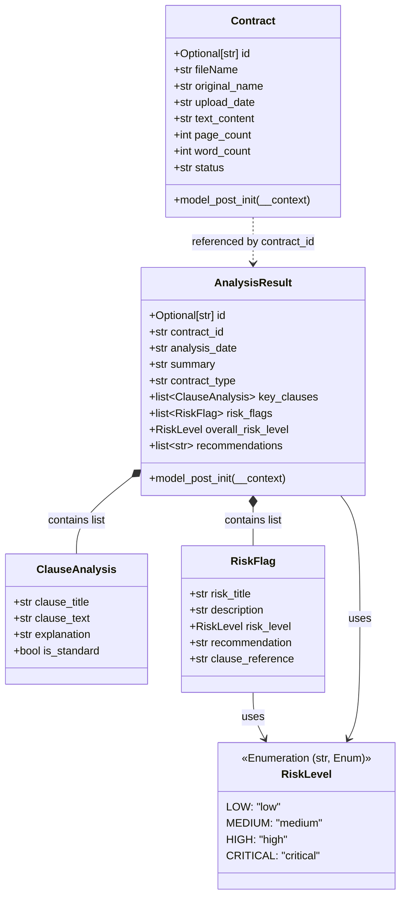

# 📐 Deep-Dive Guide: `app/models.py` (Vakil-Contract-Vision)

> **File:** [`app/models.py`](file:///c:/Users/ADMIN/Documents/hemant-python/Vakil-Contract-Vision/app/models.py)  
> **Role in Architecture:** Domain Modeling & Data Validation Layer. Defines Pydantic V2 schemas, String Enums, nested sub-document representations, and automated timestamp lifecycle hooks for contracts and legal analysis reports.

---

## 🧭 Navigation
- ⬅️ **Previous File:** [`docs/03_file_guide_database_py.md`](03_file_guide_database_py.md) &mdash; PyMongo Client & Database Indexing
- ➡️ **Next File:** [`docs/05_file_guide_document_parser_py.md`](05_file_guide_document_parser_py.md) &mdash; Document Parsing & Page/Word Extraction

---

## 🎯 1. Why We Use It

MongoDB is deliberately **schemaless**. While this provides flexibility, raw Python dictionaries (`dict`) introduce dangerous vulnerabilities into production code:
1. **Silent Typo Bugs:** Writing `doc["clause_title"]` in one file and `doc["title"]` in another will silently corrupt records or crash with unhandled `KeyError` exceptions.
2. **Untrusted LLM Output:** Large Language Models (like Google Gemini) are probabilistic. They can hallucinate extra fields, omit required properties, or return invalid types (e.g., returning an integer instead of a string).
3. **API Contract & Documentation Drift:** Without formal models, FastAPI cannot generate Swagger (`/docs`) schemas, leaving API consumers guessing about response shapes.

[`app/models.py`](file:///c:/Users/ADMIN/Documents/hemant-python/Vakil-Contract-Vision/app/models.py) leverages **Pydantic V2** to enforce strict compile-time and runtime validation. It acts as an **immune system** between the outside world (HTTP requests, LLM outputs) and our persistent database.



---

## 🔍 2. Full Code & Line-by-Line Deep Dive

Here is the exact code of [`app/models.py`](file:///c:/Users/ADMIN/Documents/hemant-python/Vakil-Contract-Vision/app/models.py):

```python
from pydantic import BaseModel
from typing import Optional
from datetime import datetime
from enum import Enum


class RiskLevel(str, Enum):
    LOW = "low"
    MEDIUM = "medium"
    HIGH = "high"
    CRITICAL = "critical"


class Contract(BaseModel):
    id: Optional[str] = None
    fileName: str
    original_name: str
    upload_date: str = ""
    text_content: str = ""
    page_count: int = 0
    word_count: int = 0
    status: str = "uploaded"

    def model_post_init(self, __context):
        if not self.upload_date:
            self.upload_date = datetime.now().isoformat()


class ClauseAnalysis(BaseModel):
    clause_title: str
    clause_text: str
    explanation: str
    is_standard: bool

class RiskFlag(BaseModel):
    risk_title: str
    description: str
    risk_level: RiskLevel
    recommendation: str
    clause_reference: str = ""

class AnalysisResult(BaseModel):
    id: Optional[str] = None
    contract_id: str
    analysis_date: str = ""
    summary: str = ""
    contract_type: str = ""
    key_clauses: list[ClauseAnalysis] = []
    risk_flags: list[RiskFlag] = []
    overall_risk_level: RiskLevel = RiskLevel.LOW
    recommendations: list[str] = []

    def model_post_init(self, __context):
        if not self.analysis_date:
            self.analysis_date = datetime.now().isoformat()
```

---

### Detailed Breakdown

#### Lines 7–11: `class RiskLevel(str, Enum):`
* **What it does:** Declares a strict enumerated set of legal risk severity levels: `low`, `medium`, `high`, `critical`.
* **Why inherit from both `str` and `Enum`?**
  * In standard Python, inheriting from `Enum` alone causes JSON serialization issues: the object serializes as `<RiskLevel.LOW: 'low'>`, which crashes `json.dumps()`.
  * By inheriting from `(str, Enum)`, the enum member **is** simultaneously a native Python `str`. It serializes cleanly to `"low"` in JSON and allows direct string comparisons:
    ```python
    if flag.risk_level == "critical": # Works instantly!
    ```

#### Lines 14–26: `class Contract(BaseModel):`
* **Purpose:** Represents the persistent state of an uploaded contract in `contracts_collection`.
* **Field Highlights:**
  * `id: Optional[str] = None`: Populated after MongoDB assigns an `_id` upon insertion.
  * `fileName: str`: Unique storage filename (e.g., `4a7b9c...pdf`).
  * `original_name: str`: Human-readable filename uploaded by the user (`Employment_Agreement_2026.pdf`).
  * `page_count` & `word_count`: Metrics extracted by [`document_parser.py`](file:///c:/Users/ADMIN/Documents/hemant-python/Vakil-Contract-Vision/app/service/document_parser.py).
* **The Pydantic V2 `model_post_init` Lifecycle:**
  ```python
  def model_post_init(self, __context):
      if not self.upload_date:
          self.upload_date = datetime.now().isoformat()
  ```
  * In Pydantic V2, `model_post_init` runs immediately after model instantiation and validation are complete.
  * If the caller does not pass `upload_date`, it automatically records the current UTC timestamp in ISO 8601 format (`2026-11-27T17:55:00.123456`).

#### Lines 29–33: `class ClauseAnalysis(BaseModel):`
* **Purpose:** Captures a single parsed legal clause from the agreement.
* **Fields:**
  * `clause_title`: Standardized name (e.g., *"Non-Compete Covenant"*).
  * `clause_text`: The verbatim excerpt copied from the contract.
  * `explanation`: Plain-English explanation generated by the LLM for non-lawyers.
  * `is_standard`: Boolean indicating whether this clause is customary market practice or highly unusual.

#### Lines 35–40: `class RiskFlag(BaseModel):`
* **Purpose:** Represents an identified legal risk or one-sided liability.
* **Fields:**
  * `risk_title`: Summary of the risk (e.g., *"Void Restraint of Trade under Section 27"*).
  * `description`: In-depth legal reasoning.
  * `risk_level`: Type-enforced `RiskLevel` Enum (`low`, `medium`, `high`, `critical`).
  * `recommendation`: Specific counter-proposal for renegotiation.

#### Lines 42–55: `class AnalysisResult(BaseModel):`
* **Purpose:** The root report object combining the complete AI audit.
* **Composition:** Contains nested lists of other Pydantic models:
  * `key_clauses: list[ClauseAnalysis]`
  * `risk_flags: list[RiskFlag]`
* **Automatic Timestamping:** Uses `model_post_init` to stamp `analysis_date` automatically.

---

## ⚡ 3. The LLM Validation Barrier (Why Pydantic is Crucial for GenAI)

In [`app/service/gemini_analyze.py`](file:///c:/Users/ADMIN/Documents/hemant-python/Vakil-Contract-Vision/app/service/gemini_analyze.py), we receive raw JSON from Google Gemini. Look at how Pydantic protects the system:

```python
key_clauses = [ClauseAnalysis(**clause) for clause in analysis_data.get("key_clauses", [])]
risk_flags = [RiskFlag(**risk) for risk in analysis_data.get("risk_flags", [])]
```

### What happens if Gemini hallucinates?
1. **Case A: Gemini outputs an invalid risk level** (e.g., `"risk_level": "EXTREME"`):
   * Pydantic immediately intercepts:
     ```text
     pydantic_core._pydantic_core.ValidationError: 1 validation error for RiskFlag
     risk_level
       Input should be 'low', 'medium', 'high' or 'critical' [type=enum, input_value='EXTREME']
     ```
   * The bad data is caught before it is saved into MongoDB!
2. **Case B: Gemini omits a required field** (e.g., missing `clause_text`):
   * Pydantic raises a clear `ValidationError: Field required` rather than corrupting your reporting dashboard with `NoneType` bugs.

---

## ⚖️ 4. Alternative Approaches vs Pydantic V2

| Approach | Runtime Validation | Type Coercion | Serialization Speed | OpenAPI / Swagger Integration |
| :--- | :--- | :--- | :--- | :--- |
| **Pydantic V2 (Our Choice)** | ✅ Strict & Instant | ✅ Automatic (`str` &rarr; `int`) | 🚀 Blazing (Written in Rust) | ✅ Native in FastAPI |
| **Standard `@dataclass`** | ❌ None at runtime | ❌ None | Moderate | ⚠️ Requires third-party tools |
| **Plain Python `dict`** | ❌ None (Primitive) | ❌ None | Fast | ❌ Zero Swagger documentation |
| **`marshmallow`** | ✅ Via Schema classes | ✅ Supported | 🐢 Slower (Pure Python) | ⚠️ Requires manual plugins |

---

## 🧠 5. How to Permanently Remember It (Mental Analogies)

### Analogy 1: The Cookie Cutter & The Stencil
* No matter how messy or oddly shaped the dough (unstructured LLM output or user input) is, pressing a **cookie cutter (`Contract` / `AnalysisResult`)** guarantees that every baked cookie has the exact same dimensions, weight, and edges.
* If a piece of dough has a rock in it (invalid data type), the cookie cutter catches it before baking.

### Analogy 2: The Customs Border Control Officer
* Data arriving from the outside world (Gemini API or HTTP file uploads) is like incoming international cargo.
* `ClauseAnalysis` and `RiskFlag` are **Customs Inspection Officers**. They check every cargo box:
  * Does it have a valid passport? (`risk_level in ["low", "medium", "high", "critical"]`).
  * If anything is counterfeit or missing, the cargo is detained at the border before it enters the country (the database).

---

## 💼 6. Senior Technical Interview Battle Cards

### Q1: Why should an Enum in a FastAPI / Pydantic application inherit from `(str, Enum)` instead of just `Enum`?
> **Answer:**  
> Standard Python `Enum` values serialize to their object representation (e.g., `<RiskLevel.LOW: 'low'>`), which is not JSON-serializable by default and requires custom serializers. By inheriting from `(str, Enum)`, each member is simultaneously an instance of `str`. This guarantees automatic JSON serialization into plain string literals (`"low"`), allows direct equality comparisons against strings (`if risk == "critical"`), and renders clean enum dropdowns in FastAPI's Swagger UI.

### Q2: How does Pydantic V2's `model_post_init` differ from overriding `__init__` or using `@validator` in Pydantic V1?
> **Answer:**  
> In Pydantic V1, developers frequently had to override `__init__` or write `@root_validator(pre=False)` to execute custom post-processing logic, which risked breaking internal validation pipelines. In Pydantic V2 (backed by the compiled `pydantic-core` Rust engine), `model_post_init(self, __context)` is the official, lifecycle-safe hook. It is guaranteed to execute *after* all fields have been fully parsed, validated, and type-coerced, making it the ideal place for setting dynamic defaults like UTC timestamps (`upload_date = datetime.now().isoformat()`).

### Q3: What is the performance difference between Pydantic V1 and Pydantic V2?
> **Answer:**  
> Pydantic V2 rewrote the entire validation and serialization core from pure Python into **Rust** (`pydantic-core`). As a result, data validation is **5x to 50x faster**, JSON serialization via `model_dump_json()` outperforms the standard library `json.dumps()`, and memory overhead per model instance is drastically reduced.

### Q4: How do `model_dump()` and `model_dump_json()` differ in Pydantic V2?
> **Answer:**  
> `model_dump()` converts the Pydantic model into a native Python dictionary (`dict`), which is what we pass to PyMongo's `insert_one(doc)`.  
> In contrast, `model_dump_json()` serializes the model directly into a UTF-8 JSON string via Rust, bypassing Python dictionary creation entirely for maximum HTTP throughput.

---

## 🔗 Next Step
Proceed to **File 5**: [`docs/05_file_guide_document_parser_py.md`](05_file_guide_document_parser_py.md) to explore how `PyPDF2` and custom string decoders extract raw text, compute page counts, and sanitize contract content.
