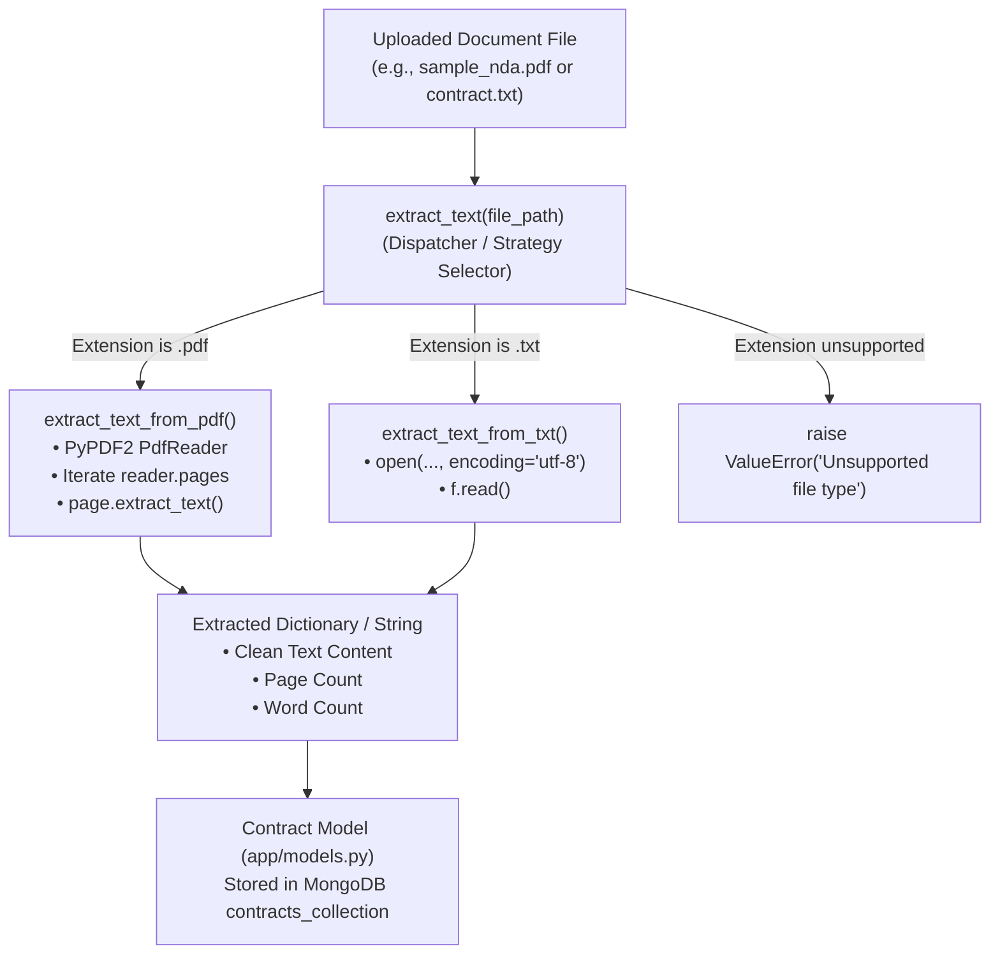

# 📄 Deep-Dive Guide: `app/service/document_parser.py` (Vakil-Contract-Vision)

> **File:** [`app/service/document_parser.py`](file:///c:/Users/ADMIN/Documents/hemant-python/Vakil-Contract-Vision/app/service/document_parser.py)  
> **Role in Architecture:** Document Ingestion & Text Extraction Engine. Implements the **Strategy / Dispatcher Pattern** to extract raw text content, count pages, and compute word metrics from uploaded `.pdf` and `.txt` legal agreements.

---

## 🧭 Navigation
- ⬅️ **Previous File:** [`docs/04_file_guide_models_py.md`](04_file_guide_models_py.md) &mdash; Pydantic V2 Data Models & Enums
- ➡️ **Next File:** [`docs/06_file_guide_prompt_py.md`](06_file_guide_prompt_py.md) &mdash; Indian Contract Law Prompt Engineering & JSON Structuring

---

## 🎯 1. Why We Use It

Large Language Models (LLMs) like Google Gemini cannot directly parse raw binary PDF byte-streams or manage varied disk file encodings. Before an AI model can analyze an NDA, employment agreement, or vendor service contract, the system must:
1. **Decode the File:** Translate binary disk objects into normalized, UTF-8 encoded plain text strings.
2. **Compute Document Metrics:** Calculate the total page count and word count for legal audit records and token usage estimation.
3. **Abstract Format Complexity:** Shield the FastAPI route layer (`contracts_routes.py`) from having to know whether an uploaded contract is a PDF, a TXT file, or a future DOCX document.

`document_parser.py` acts as the dedicated **Text Ingestion Gateway**, decoupling file format extraction mechanics from web routing and AI analysis.



---

## 🔍 2. Full Code & Line-by-Line Deep Dive

Here is the exact code of [`app/service/document_parser.py`](file:///c:/Users/ADMIN/Documents/hemant-python/Vakil-Contract-Vision/app/service/document_parser.py):

```python
import os
from PyPDF2 import PdfReader

def extract_text_from_txt(file_path: str) -> str:
    """
    Extracts text from a TXT file.

    Args:
        file_path (str): The path to the TXT file.
    """
    with open(file_path, "r", encoding="utf-8") as f:
        return f.read()
    return {"text": text.strip(), "page_count": "1", "word_count": str(len(text.split()))}


def extract_text_from_pdf(file_path: str) -> str:
    """
    Extracts text from a PDF file.
    
    Args:
        file_path (str): The path to the PDF file.
    """
    reader = PdfReader(file_path)
    text=""
    for page in reader.pages:
        text += page.extract_text() + "\n"
    return {"text": text.strip(), "page_count": str(len(reader.pages)), "word_count": str(len(text.split()))}
    

def extract_text(file_path: str) -> str:
    """Extracts text from a document file.
    
    Args:
        file_path (str): The path to the document file.
    """

    extension = os.path.splitext(file_path)[1].lower()

    if extension == ".pdf":
        return extract_text_from_pdf(file_path)
    elif extension == ".txt":
        return extract_text_from_txt(file_path)
    else:
        raise ValueError("Unsupported file type. Only PDF and TXT files are allowed.")
```

---

### Detailed Breakdown

#### Lines 1–2: `import os` and `from PyPDF2 import PdfReader`
* **`os`:** Standard library module used to inspect file paths and isolate file extensions via `os.path.splitext()`.
* **`PyPDF2.PdfReader`:** A pure-Python PDF manipulation library capable of parsing PDF binary structures, cross-reference tables (XREF), stream dictionaries, and extracting font-encoded glyph text from individual page objects.

#### Lines 4–14: `extract_text_from_txt(file_path: str)`
* **The Context Manager (`with open(...) as f:`):**
  * Guarantees that the underlying OS file descriptor is automatically closed the instant block execution leaves, even if an exception occurs during reading.
* **The Critical `encoding="utf-8"` Flag:**
  * On Windows machines, standard `open(file_path, "r")` defaults to the legacy Windows ANSI code page (`cp1252`). If a legal contract contains non-ASCII characters (such as the Indian Rupee symbol `₹`, em-dashes `—`, or smart quotes `“ ”`), `cp1252` crashes with a `UnicodeDecodeError`. Explicitly passing `encoding="utf-8"` guarantees cross-platform stability.
* **Code Review & Architectural Observation (Dead Code Analysis):**
  * Notice Line 12: `return f.read()`.
  * Because `return` exits the function immediately, Line 13 (`return {"text": text.strip(), ...}`) is **unreachable dead code**.
  * As a result, `extract_text_from_txt` returns a raw string (`str`), whereas `extract_text_from_pdf` returns a structured dictionary (`dict`).
  * Look at how our router [`app/routes/contracts_routes.py`](file:///c:/Users/ADMIN/Documents/hemant-python/Vakil-Contract-Vision/app/routes/contracts_routes.py#L44-L46) defensively handles this discrepancy:
    ```python
    text_content=parsed["text"] if isinstance(parsed, dict) else parsed,
    page_count=int(parsed["page_count"]) if isinstance(parsed, dict) else len(parsed.splitlines()),
    ```
    *This is a classic example of defensive programming in microservices!*

#### Lines 16–28: `extract_text_from_pdf(file_path: str)`
* **`reader = PdfReader(file_path)`:** Opens the binary PDF file and loads the document catalog and page tree into memory.
* **Page Iteration Loop:**
  ```python
  text = ""
  for page in reader.pages:
      text += page.extract_text() + "\n"
  ```
  * Iterates through every page object sequentially.
  * `page.extract_text()` parses content streams and translates font operators into Unicode characters.
  * Appends a newline `\n` to prevent words at the bottom of Page 1 from colliding into words at the top of Page 2.
* **Metric Generation:**
  * `page_count`: Directly calculated using `len(reader.pages)`.
  * `word_count`: Calculated using Python’s whitespace tokenizer `len(text.split())`.

#### Lines 30–44: `extract_text(file_path: str)` (The Dispatcher)
* **`os.path.splitext(file_path)[1].lower()`:** Splits a path like `/uploads/nda_v2.PDF` into `('/uploads/nda_v2', '.PDF')`, and `.lower()` normalizes it to `'.pdf'`.
* **The Strategy Selector:**
  * If `.pdf` &rarr; invokes `extract_text_from_pdf(file_path)`.
  * If `.txt` &rarr; invokes `extract_text_from_txt(file_path)`.
  * Else &rarr; raises `ValueError`.
* **Design Pattern (Open/Closed Principle):** If we want to support Word documents (`.docx`) in the future, we simply add a helper `extract_text_from_docx()` and one `elif extension == ".docx":` branch. The API routing layer requires zero modifications!

---

## ⚡ 3. Real-World Edge Cases in Legal Document Ingestion

### Edge Case A: The "Scanned Image" Trap (No Text Layer)
* **The Problem:** A party signs a physical contract with a pen, scans it using a commercial office scanner, and uploads the resulting PDF.
* **What Happens:** `page.extract_text()` returns an empty string `""`!
* **Why:** The PDF does not contain text glyphs; it contains a single large TIFF/JPEG bitmap image embedded inside a PDF container.
* **Production Solution:**
  In enterprise production, you check:
  ```python
  if len(extracted_text.strip()) == 0:
      # Trigger OCR Engine (e.g., Tesseract or AWS Textract)
      extracted_text = run_ocr_on_pdf(file_path)
  ```

---

### Edge Case B: Multi-Column Legal Layouts
* Standard contracts often feature two-column indemnification schedules or dual-party signing blocks.
* Naive text extraction can read horizontally across both columns (`Column 1 Line 1` + `Column 2 Line 1`), corrupting legal clauses.
* Modern libraries like `pdfplumber` or `PyMuPDF` use layout analysis algorithms to preserve column boundaries.

---

## ⚖️ 4. Alternative Document Extraction Engines

| Library / Tool | Engine Type | Speed | Layout & Tables | OCR (Scanned Docs) | Best Use Case |
| :--- | :--- | :--- | :--- | :--- | :--- |
| **`PyPDF2` (Our Choice)** | Pure Python | ⚡ Fast & Lightweight | Basic | ❌ No | Rapid text extraction for digital contracts |
| **`pdfplumber`** | Python + `pdfminer.six` | 🐢 Slower | ⭐⭐⭐⭐⭐ Exceptional table extraction | ❌ No | Complex financial statements & contracts with tables |
| **`PyMuPDF (fitz)`** | C-based MuPDF binding | 🚀 Fastest (10x faster) | ⭐⭐⭐⭐ Very High | ❌ No | High-throughput enterprise document processing |
| **`Tesseract OCR / AWS Textract`** | Computer Vision / Deep Learning | 🐢 Slowest | High | ✅ Yes (Scanned images) | Physical paper scans and mobile photos |

---

## 🧠 5. How to Permanently Remember It (Mental Analogies)

### Analogy 1: The Swiss Army Knife with Interchangeable Blades (The Dispatcher)
* When you want to open something, you don't buy three separate tools. You carry a **Swiss Army Knife (`extract_text`)**.
* When presented with a bottle (`.txt`), it swings out the corkscrew (`extract_text_from_txt`).
* When presented with a can (`.pdf`), it swings out the can opener (`extract_text_from_pdf`).
* If presented with an alien object (`.xyz`), it stops and says: *"I don't have a blade for this!" (`ValueError`)*.

### Analogy 2: The Legal Stenographer (Transcriber)
* An executive receives contracts on cassette tapes, parchment scrolls, and digital audio.
* The executive doesn't want to fiddle with tape decks; they hand the artifact to the **Court Stenographer (`document_parser.py`)**.
* The stenographer types out a clean, uniform transcript on standard A4 paper, counts the words, counts the pages, and hands the clean transcript to the Senior Legal Partner (`gemini_analyze.py`).

---

## 💼 6. Senior Technical Interview Battle Cards

### Q1: What is the Strategy / Dispatcher pattern, and how does `extract_text()` implement it?
> **Answer:**  
> The Strategy pattern defines a family of algorithms (extracting text from different file formats), encapsulates each one inside a separate function (`extract_text_from_pdf`, `extract_text_from_txt`), and makes them interchangeable. The dispatcher function `extract_text()` inspects the document's extension and dynamically delegates execution to the appropriate strategy. This adheres to the **Open/Closed Principle (OCP)** &mdash; new formats (like `.docx` or `.html`) can be added without modifying the consumer routes.

### Q2: Why is specifying `encoding="utf-8"` mandatory when calling `open()` on Windows?
> **Answer:**  
> On Windows, Python's `open()` function defaults to the active system code page (typically `Windows-1252` or `cp1252` in Western locales) rather than UTF-8. Legal contracts frequently contain non-ASCII characters, such as the Indian Rupee sign (`₹`), section markers (`§`), em-dashes (`—`), or curly quotation marks. Without `encoding="utf-8"`, Python raises a `UnicodeDecodeError: 'charmap' codec can't decode byte...` and crashes the upload endpoint.

### Q3: What is the fundamental limitation of `PyPDF2` when processing scanned documents, and how would you resolve it in production?
> **Answer:**  
> `PyPDF2` is a textual and structural parser for digital PDFs. It reads the document's internal content streams (`TJ` and `Tj` PDF operators). If a document was created by scanning physical paper, the PDF contains only an embedded raster image (`XObject` of subtype `Image`) and no font streams; `PyPDF2` will return an empty string. In production, we resolve this by inspecting the extracted text length: if it falls below a threshold (e.g., < 20 characters on a 3-page document), the system falls back to an Optical Character Recognition (OCR) pipeline such as Tesseract, AWS Textract, or Google Cloud Document AI.

### Q4: How would you refactor `extract_text_from_txt` to eliminate the dead code and unify return types?
> **Answer:**  
> Currently, line 12 returns `f.read()`, causing line 13 to be dead code and resulting in an inconsistent interface where PDF returns a dictionary but TXT returns a string. The refactored version would normalize the return contract:
> ```python
> def extract_text_from_txt(file_path: str) -> dict:
>     with open(file_path, "r", encoding="utf-8") as f:
>         text = f.read().strip()
>     return {
>         "text": text,
>         "page_count": 1,
>         "word_count": len(text.split())
>     }
> ```
> This ensures both extractors return identical dictionary schemas with typed integer counts.

---

## 🔗 Next Step
Proceed to **File 6**: [`docs/06_file_guide_prompt_py.md`](06_file_guide_prompt_py.md) to explore how prompt engineering incorporates Indian Contract Law rules (e.g., Section 27 Restraint of Trade) and forces deterministic JSON generation from Google Gemini.
