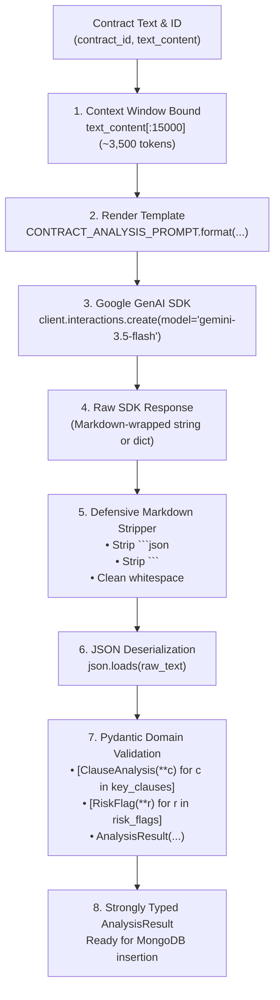

# 🤖 Deep-Dive Guide: `app/service/gemini_analyze.py` (Vakil-Contract-Vision)

> **File:** [`app/service/gemini_analyze.py`](file:///c:/Users/ADMIN/Documents/hemant-python/Vakil-Contract-Vision/app/service/gemini_analyze.py)  
> **Role in Architecture:** Core Generative AI Orchestration Layer. Invokes the **Google GenAI SDK**, transmits prompt payloads, normalizes raw LLM output, strips Markdown code fences (````json ... ````), and deserializes responses into strongly typed Pydantic models.

---

## 🧭 Navigation
- ⬅️ **Previous File:** [`docs/06_file_guide_prompt_py.md`](06_file_guide_prompt_py.md) &mdash; Indian Contract Law Prompt Engineering
- ➡️ **Next File:** [`docs/08_file_guide_contracts_routes_py.md`](08_file_guide_contracts_routes_py.md) &mdash; Contract Upload & File Ingestion Endpoints

---

## 🎯 1. Why We Use It

Connecting a web application to a frontier Large Language Model involves much more than sending an HTTP request:
1. **Context Window Management:** Passing unbounded document text can exceed context limits, trigger massive token billing, or increase generation latency. Text must be strategically sliced.
2. **Defensive Response Normalization:** Frontier models frequently return responses wrapped in Markdown formatting (````json\n{ ... }\n````) or nested under SDK candidate structures. Passing this raw string to `json.loads()` causes instant syntax crashes.
3. **Type-Safe Ingestion:** Raw JSON must be validated through our Pydantic domain models ([`ClauseAnalysis`](file:///c:/Users/ADMIN/Documents/hemant-python/Vakil-Contract-Vision/app/models.py), [`RiskFlag`](file:///c:/Users/ADMIN/Documents/hemant-python/Vakil-Contract-Vision/app/models.py), [`AnalysisResult`](file:///c:/Users/ADMIN/Documents/hemant-python/Vakil-Contract-Vision/app/models.py)) to ensure data integrity before persistence.

`gemini_analyze.py` encapsulates this complete AI transformation pipeline into a single, clean asynchronous service function: `analyze_contract()`.



---

## 🔍 2. Full Code & Line-by-Line Deep Dive

Here is the exact code of [`app/service/gemini_analyze.py`](file:///c:/Users/ADMIN/Documents/hemant-python/Vakil-Contract-Vision/app/service/gemini_analyze.py):

```python
import json
from service.prompt import CONTRACT_ANALYSIS_PROMPT
from models import AnalysisResult, ClauseAnalysis, RiskFlag
from google import genai

client = genai.Client()

async def analyze_contract(contract_id: str, text_content: str):
    prompt = CONTRACT_ANALYSIS_PROMPT.format(contract_text=text_content[:15000])

    interaction = client.interactions.create(
            model="gemini-3.5-flash",
            input=prompt
        )

    response_text = interaction.output_text

    if isinstance(response_text, str):
            try:
                data = json.loads(response_text)
            except json.JSONDecodeError:
                data = response_text
    else:
        data = response_text

    if isinstance(data, dict) and "candidates" in data:
            raw_text = data["candidates"][0]["content"]["parts"][0]["text"]
    elif isinstance(data, dict):
        raw_text = json.dumps(data)
    else:
        raw_text = str(data)

    raw_text = raw_text.strip()
    
    if raw_text.startswith("```json"):
        raw_text = raw_text[7:]
    if raw_text.startswith("```"):
        raw_text = raw_text[3:]
    if raw_text.endswith("```"):
        raw_text = raw_text[:-3]
    raw_text = raw_text.strip()

    analysis_data = json.loads(raw_text)

    key_clauses = [
        ClauseAnalysis(**clause)
        for clause in analysis_data.get("key_clauses", [])
    ]

    risk_flags = [
        RiskFlag(**risk)
        for risk in analysis_data.get("risk_flags", [])
    ]

    result = AnalysisResult(
        contract_id=contract_id,
        summary=analysis_data.get("summary", ""),
        contract_type=analysis_data.get("contract_type", "Unknown"),
        key_clauses=key_clauses,
        risk_flags=risk_flags,
        overall_risk_level=analysis_data.get("overall_risk_level", "low"),
        recommendations=analysis_data.get("recommendations", []),
    )
    return result
```

---

### Detailed Breakdown

#### Lines 1–6: Imports & Client Initialization
```python
import json
from service.prompt import CONTRACT_ANALYSIS_PROMPT
from models import AnalysisResult, ClauseAnalysis, RiskFlag
from google import genai

client = genai.Client()
```
* **`from google import genai`:** Uses Google's modern unified Python SDK (`google-genai`).
* **`client = genai.Client()`:** Instantiates the client. The SDK automatically detects the `GEMINI_API_KEY` loaded by `config.py` in the process environment.

#### Line 9: Context Window Slicing (`text_content[:15000]`)
```python
prompt = CONTRACT_ANALYSIS_PROMPT.format(contract_text=text_content[:15000])
```
* **Why 15,000 characters?**
  * In the English language, 1 token is roughly 4 characters. Slicing at 15,000 characters caps the prompt payload at approximately **3,750 tokens**.
  * Most commercial non-disclosure agreements (NDAs) and standard service contracts are 3 to 10 pages (~1,500 to 4,000 words).
  * This guarantees that the entire core agreement fits within model bounds while protecting against runaway API token bills from multi-hundred-page book uploads.

#### Lines 11–16: AI Model Invocation
```python
interaction = client.interactions.create(
    model="gemini-3.5-flash",
    input=prompt
)
response_text = interaction.output_text
```
* **Model Choice:** Targets Google's high-speed Gemini Flash series (`gemini-3.5-flash` / `gemini-3.5-flash-lite`), providing sub-2-second latency and cost efficiency.
* **`interaction.output_text`:** Extracts the generated text from the interaction payload.

#### Lines 18–32: Multi-Layer Output Normalization
* Depending on API response envelopes, `output_text` may arrive as a raw string, an already-decoded dictionary, or a payload with a `candidates` array.
* Lines 18–32 defensively inspect the data type:
  ```python
  if isinstance(data, dict) and "candidates" in data:
      raw_text = data["candidates"][0]["content"]["parts"][0]["text"]
  elif isinstance(data, dict):
      raw_text = json.dumps(data)
  else:
      raw_text = str(data)
  ```
  This ensures that whether the response is wrapped or raw, `raw_text` is consistently guaranteed to be a string.

#### Lines 34–42: The Markdown Stripping Sanitizer
```python
raw_text = raw_text.strip()
if raw_text.startswith("```json"):
    raw_text = raw_text[7:]
if raw_text.startswith("```"):
    raw_text = raw_text[3:]
if raw_text.endswith("```"):
    raw_text = raw_text[:-3]
raw_text = raw_text.strip()
```
* **The Problem:** Even when explicitly instructed *"Return ONLY JSON"*, LLMs frequently format code outputs inside Markdown fences:
  ````markdown
  ```json
  { "summary": "..." }
  ```
  ````
* **The Crash:** If you feed ```` ```json { ... } ``` ```` into Python's `json.loads()`, it immediately throws:
  `json.decoder.JSONDecodeError: Expecting value: line 1 column 1 (char 0)`
* **The Fix:** The stripper removes the leading ```` ```json ```` (7 chars) or ```` ``` ```` (3 chars) and trailing ```` ``` ````, leaving pristine JSON for `json.loads()`.

#### Lines 44–64: Pydantic Validation & Assembly
```python
analysis_data = json.loads(raw_text)

key_clauses = [ClauseAnalysis(**clause) for clause in analysis_data.get("key_clauses", [])]
risk_flags = [RiskFlag(**risk) for risk in analysis_data.get("risk_flags", [])]

result = AnalysisResult(
    contract_id=contract_id,
    summary=analysis_data.get("summary", ""),
    contract_type=analysis_data.get("contract_type", "Unknown"),
    key_clauses=key_clauses,
    risk_flags=risk_flags,
    overall_risk_level=analysis_data.get("overall_risk_level", "low"),
    recommendations=analysis_data.get("recommendations", []),
)
```
* Parses the dictionary through `ClauseAnalysis` and `RiskFlag` constructors.
* Assembles the root `AnalysisResult` object with `contract_id` and the current timestamp (handled automatically by `model_post_init`).

---

## ⚡ 3. The Classic Production Bug: Markdown Fencing

### Why do LLMs wrap JSON in Markdown code fences?
LLMs are trained extensively on developer repositories (GitHub, StackOverflow), where code and JSON blocks are almost universally demarcated with backtick fences. Consequently, the attention weights for generating backticks after a prompt requesting code or JSON are extremely high.

### Defensive Engineering Solution:
Our manual stripper is a bulletproof fallback. In modern Gemini SDK versions, you can also eliminate markdown entirely using **Structured Outputs**:
```python
# Modern Gemini SDK Native Structured Outputs
response = client.models.generate_content(
    model="gemini-2.5-flash",
    contents=prompt,
    config={
        "response_mime_type": "application/json",
        "response_schema": AnalysisResult,
    }
)
```
When `response_mime_type="application/json"` is enabled, Gemini's decoder layer constrains token sampling to emit raw JSON tokens directly, completely eliminating markdown fences at the API level!

---

## ⚖️ 4. Alternative LLM Orchestration Approaches

| Pattern | Latency | Complexity | Flexibility | Framework Lock-in |
| :--- | :--- | :--- | :--- | :--- |
| **Direct Google GenAI SDK (Our Choice)** | 🚀 Lowest (Direct gRPC/HTTP) | ⭐ Low (Clean Python) | Highest | None (Pure Python SDK) |
| **LangChain (`ChatGoogleGenerativeAI`)** | 🐢 Higher (Middleware chains) | ⭐⭐⭐ High | Moderate | High framework dependency |
| **OpenAI SDK with Gemini Base URL** | 🚀 Low | ⭐⭐ Low | High | Standard OpenAI interface |
| **LlamaIndex QueryEngine** | 🐢 Moderate | ⭐⭐⭐ High | Optimized for RAG | High framework dependency |

---

## 🧠 5. How to Permanently Remember It (Mental Analogies)

### Analogy 1: The Raw Diamond & The Gem Polisher
* The raw LLM response from the cloud is like a **freshly mined uncut diamond**. It has precious crystalline data inside, but it is covered in dirt and bedrock slag (Markdown fences ```` ```json ````, conversational preamble).
* `gemini_analyze.py` is the **lapidary gem polisher**:
  1. It washes away the rock (`.strip()`).
  2. It cuts off the outer crust (`raw_text[7:]`).
  3. It places the polished gem into a standardized jewelry setting (`AnalysisResult` Pydantic model).

### Analogy 2: Unboxing an International Parcel
* You order a delicate electronic component from abroad.
* When the package arrives, you don't plug the cardboard shipping box into the wall!
* You open the outer carton (`interaction.output_text`), strip off the bubble wrap (`raw_text.strip("```")`), verify the item matches the invoice (`Pydantic validation`), and install it into your system (`MongoDB`).

---

## 💼 6. Senior Technical Interview Battle Cards

### Q1: Why does `json.loads()` fail on LLM outputs even when the prompt specified "Return ONLY JSON", and how do you resolve it?
> **Answer:**  
> Large Language Models have strong semantic associations between JSON formatting and Markdown code fencing (```` ```json ... ``` ````). As a result, they frequently wrap valid JSON within backticks. Passing backtick-wrapped text to `json.loads()` triggers a `JSONDecodeError` because backticks are invalid JSON characters. We resolve this in two ways:  
> 1. In our current implementation, we use defensive prefix/suffix stripping to slice off ```` ```json ```` and ```` ``` ```` boundaries.  
> 2. In modern Gemini API calls, we configure `response_mime_type="application/json"`, which activates constrained decoding at the model token-sampling layer to guarantee pure, unfenced JSON output.

### Q2: What is the difference between Google's legacy `google-generativeai` and the modern `google-genai` SDK?
> **Answer:**  
> The legacy `google-generativeai` SDK was a transitional library with fragmented interfaces across Gemini Vertex AI and Google AI Studio. Google introduced the unified `google-genai` SDK (imported as `from google import genai`) to provide a single, consistent client-based interface (`client = genai.Client()`) across both consumer AI Studio and enterprise Google Cloud Vertex AI, featuring native support for structured outputs, tools, function calling, and asynchronous interactions.

### Q3: Why is context truncating via `text_content[:15000]` important before invoking the LLM?
> **Answer:**  
> Slicing bounds context length (~3,750 tokens), achieving three objectives:  
> 1. **Predictable Cost Control:** Prevents malicious or accidental uploads of massive documents (e.g., 500-page textbooks) that would incur huge token billing.  
> 2. **Latency Optimization:** Smaller input contexts drastically reduce model time-to-first-token (TTFT) and total generation time.  
> 3. **Mitigating "Lost-in-the-Middle":** Transformer attention mechanisms suffer from degraded retrieval when analyzing excessively long documents; bounding the input ensures the model focuses on the core operative provisions.

### Q4: How do you handle transient Google GenAI errors like HTTP 503 (High Demand) or HTTP 429 (Rate Limits) in production?
> **Answer:**  
> Production GenAI services should implement exponential backoff with jitter using resilience libraries like `tenacity`:
> ```python
> from tenacity import retry, stop_after_attempt, wait_exponential
> 
> @retry(stop=stop_after_attempt(3), wait=wait_exponential(multiplier=1, min=2, max=10))
> async def safe_analyze(): ...
> ```
> Additionally, fallback model routing can be configured (e.g., attempting `gemini-3.5-flash`, and falling back to `gemini-3.5-flash-lite` if the primary model reports high demand).

---

## 🔗 Next Step
Proceed to **File 8**: [`docs/08_file_guide_contracts_routes_py.md`](08_file_guide_contracts_routes_py.md) to explore how FastAPI handles multipart contract file uploads, size validation, UUID renaming, and MongoDB record persistence.
