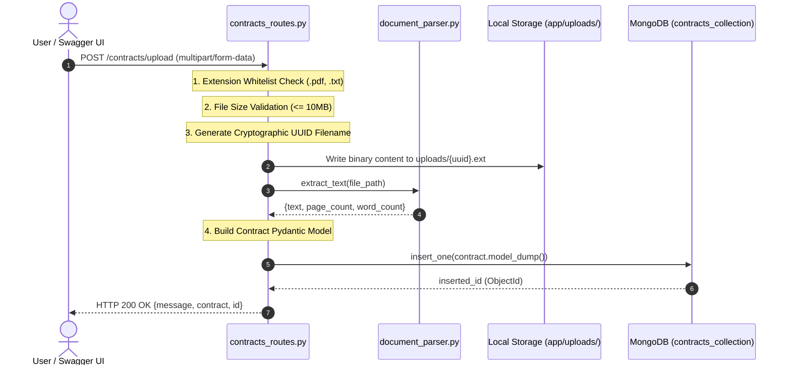

# 🛰️ Deep-Dive Guide: `app/routes/contracts_routes.py` (Vakil-Contract-Vision)

> **File:** [`app/routes/contracts_routes.py`](file:///c:/Users/ADMIN/Documents/hemant-python/Vakil-Contract-Vision/app/routes/contracts_routes.py)  
> **Role in Architecture:** Contract Ingestion & Document Catalog API Router. Handles multipart/form-data HTTP uploads, enforces cybersecurity guardrails (extension whitelisting, size limits, UUID sanitization), coordinates disk staging with text parsing, and manages contract records in MongoDB.

---

## 🧭 Navigation
- ⬅️ **Previous File:** [`docs/07_file_guide_gemini_analyze_py.md`](07_file_guide_gemini_analyze_py.md) &mdash; Google GenAI Client & JSON Deserialization
- ➡️ **Next File:** [`docs/09_file_guide_analysis_routes_py.md`](09_file_guide_analysis_routes_py.md) &mdash; AI Legal Analysis Orchestration & Report Retrieval

---

## 🎯 1. Why We Use It

Accepting user-uploaded files over the public internet is one of the highest-risk attack surfaces in web development (OWASP Top 10):
1. **Remote Code Execution (RCE):** Malicious actors upload executable scripts (`.php`, `.py`, `.exe`, `.sh`) designed to run on the server host.
2. **Path Traversal Attacks:** Uploading files named `../../../../etc/passwd` or `..\Windows\System32\malicious.dll` to overwrite critical operating system files.
3. **Denial of Service (DoS):** Uploading multi-gigabyte files to exhaust server RAM, fill the hard drive, and crash the process.
4. **Network Inefficiency:** Querying a list of 500 contracts and transmitting hundreds of thousands of words of raw contract text over the network when the UI only needs titles, dates, and page counts.

[`app/routes/contracts_routes.py`](file:///c:/Users/ADMIN/Documents/hemant-python/Vakil-Contract-Vision/app/routes/contracts_routes.py) provides a hardened, efficient ingestion pipeline that neutralizes these threats while coordinating file parsing and persistence.



---

## 🔍 2. Full Code & Line-by-Line Deep Dive

Here is the exact code of [`app/routes/contracts_routes.py`](file:///c:/Users/ADMIN/Documents/hemant-python/Vakil-Contract-Vision/app/routes/contracts_routes.py):

```python
from fastapi import APIRouter,  File, UploadFile, HTTPException
import os
import uuid
from config import ALLOWED_EXTENSIONS, MAX_FILE_SIZE_MB, UPLOAD_DIR
from service.document_parser import extract_text
from models import Contract
from database import contracts_collection
from bson import ObjectId

router = APIRouter(
    prefix="/contracts",
    tags=["contracts"]
)

@router.post("/upload")
async def upload_contract(file: UploadFile = File(...)):
    """Upload a PDF or TXT contract for analysis"""

    extension = os.path.splitext(file.filename)[1].lower()

    if extension not in ALLOWED_EXTENSIONS:
        raise HTTPException(status_code=400, detail="File type not allowed")

    content = await file.read()

    size_mb = len(content) / (1024 * 1024)

    if size_mb > MAX_FILE_SIZE_MB:
        raise HTTPException(status_code=400, detail="File size exceeds the maximum limits")

    os.makedirs(UPLOAD_DIR, exist_ok=True)
    unique_name = f"{uuid.uuid4().hex}{extension}"

    file_path = os.path.join(UPLOAD_DIR, unique_name)

    with open(file_path, "wb") as f:
        f.write(content)

    parsed = extract_text(file_path)

    contract_data = Contract(
        fileName=unique_name,
        original_name=file.filename,
        text_content=parsed["text"] if isinstance(parsed, dict) else parsed,
        page_count=int(parsed["page_count"].splitlines()) if isinstance(parsed, dict) else len(parsed.splitlines()),
        word_count=int(parsed["word_count"].split()) if isinstance(parsed, dict) else len(parsed.splitlines()),
    )

    doc = contract_data.model_dump()
    result = contracts_collection.insert_one(doc)
    contract_data.id = str(result.inserted_id)

    return {
        "message": "File uploaded and processed successfully",
        "contract": contract_data.model_dump(),
        "id": contract_data.id
    }

@router.get("/")
async def list_contracts():
    """
    List all uploaded contracts.
    """
    contracts =[]
    for doc in contracts_collection.find({},{"text_content": 0}):
        contract = Contract(**doc)
        contract.id = str(doc["_id"])
        contracts.append(contract.model_dump())
    return {"contracts": contracts}

@router.get("/{contract_id}")
async def get_contract(contract_id: str):
    """
    Retrieve a specific contract by its ID.
    """

    doc = contracts_collection.find_one({"_id": ObjectId(contract_id)})

    if not doc:
        raise HTTPException(status_code=404, detail="Contract not found")

    contract = Contract(**doc)
    contract.id = str(doc["_id"])

    return {"contract": contract.model_dump()}
```

---

### Detailed Breakdown

#### Lines 10–13: Router Initialization
```python
router = APIRouter(
    prefix="/contracts",
    tags=["contracts"]
)
```
* **`prefix="/contracts"`:** Automatically prepends `/contracts` to all routes in this file (e.g., `/contracts/upload`, `/contracts/`, `/contracts/{id}`).
* **`tags=["contracts"]`:** Groups all contract operations under a unified section in FastAPI's Swagger UI documentation (`http://127.0.0.1:8000/docs`).

---

### Endpoint 1: `POST /contracts/upload` (Lines 15–57)

#### 1. Input Parameter: `file: UploadFile = File(...)`
* **`UploadFile` vs. `bytes`:** Using `UploadFile` streams the incoming file as a Spooled Temporary File in memory. It does not load large files into RAM all at once until `.read()` is called, providing high concurrency under load.

#### 2. Defensive Security Check 1: Extension Whitelisting (Lines 19–22)
```python
extension = os.path.splitext(file.filename)[1].lower()
if extension not in ALLOWED_EXTENSIONS:
    raise HTTPException(status_code=400, detail="File type not allowed")
```
* Slices the extension (e.g., `Employment_NDA.PDF` &rarr; `'.pdf'`) and checks against `[".pdf", ".txt"]`. Rejects malicious executable files before reading their content.

#### 3. Defensive Security Check 2: Size Limit Enforcement (Lines 24–29)
```python
content = await file.read()
size_mb = len(content) / (1024 * 1024)
if size_mb > MAX_FILE_SIZE_MB:
    raise HTTPException(status_code=400, detail="File size exceeds the maximum limits")
```
* Calculates payload size in Megabytes. Rejects files exceeding 10MB with an immediate `HTTP 400 Bad Request`.

#### 4. Defensive Security Check 3: UUID Sanitization (Lines 31–37)
```python
os.makedirs(UPLOAD_DIR, exist_ok=True)
unique_name = f"{uuid.uuid4().hex}{extension}"
file_path = os.path.join(UPLOAD_DIR, unique_name)
```
* **Why UUIDs are mandatory:**
  * If a user uploads `../../../../boot.ini`, using `file.filename` directly would trigger a **Path Traversal Attack**.
  * If two users upload a file named `NDA.pdf`, saving by original name would overwrite the first user's file.
  * Generating a 32-character hexadecimal UUID (`uuid.uuid4().hex`, e.g., `d3b07384d113edec49eaa6238ad5ff00.pdf`) guarantees complete filename sanitization and zero disk collisions.

#### 5. Persistence & `ObjectId` Serialization (Lines 49–56)
```python
doc = contract_data.model_dump()
result = contracts_collection.insert_one(doc)
contract_data.id = str(result.inserted_id)
```
* Serializes the Pydantic model into a dictionary via `.model_dump()`.
* Inserts the record into MongoDB.
* Converts the returned 12-byte BSON `result.inserted_id` to a clean string `str(...)` so FastAPI can serialize it to JSON without errors.

---

### Endpoint 2: `GET /contracts/` (Lines 59–69)

#### The Projection Query Optimization
```python
for doc in contracts_collection.find({}, {"text_content": 0}):
```
* **The Magic of `{"text_content": 0}`:**
  * In MongoDB, the second parameter of `.find(query, projection)` specifies which fields to include (`1`) or exclude (`0`).
  * A 30-page agreement can contain 15,000 words (over 100 KB of text per document).
  * If a company has 1,000 contracts, fetching all documents without projection would transfer **100 Megabytes** of text over the database socket!
  * By excluding `text_content`, the query returns in milliseconds and transmits only lightweight metadata (IDs, names, page counts, timestamps).

---

### Endpoint 3: `GET /contracts/{contract_id}` (Lines 71–85)

#### BSON `ObjectId` Querying
```python
doc = contracts_collection.find_one({"_id": ObjectId(contract_id)})
if not doc:
    raise HTTPException(status_code=404, detail="Contract not found")
```
* MongoDB primary keys are stored as binary `ObjectId` instances. Querying with a raw string `{"_id": "6745..."}` returns `None`. It must be wrapped in `ObjectId(contract_id)`.
* Returns `HTTP 404 Not Found` if the document does not exist.

---

## ⚖️ 4. Alternative Approaches vs Local Disk Storage

| Storage Strategy | Performance | Complexity | Scalability | Cost |
| :--- | :--- | :--- | :--- | :--- |
| **Local Disk Storage (`UPLOAD_DIR`)** (Current) | 🚀 High (Direct local disk I/O) | ⭐ Very Low | Single Server only | Free (Local disk) |
| **Cloud Object Storage (AWS S3 / GCS)** | 🚀 High (Presigned URLs) | ⭐⭐⭐ Moderate | Unlimited (Distributed cloud) | Low ($0.023/GB) |
| **MongoDB GridFS** | 🐢 Moderate (Chunked BSON) | ⭐⭐ Low | Tied to MongoDB cluster | Scales with DB storage |

> **Production Recommendation:** For multi-container deployments (Kubernetes, AWS ECS), replace `UPLOAD_DIR` with direct uploads to Amazon S3 or Google Cloud Storage using presigned upload URLs.

---

## 🧠 5. How to Permanently Remember It (Mental Analogies)

### Analogy 1: Airport Baggage Check-in & Security X-Ray
* When you arrive at the airport with luggage (an uploaded contract):
  1. **The Scale:** The attendant checks the weight (`MAX_FILE_SIZE_MB <= 10`).
  2. **The Scanner:** Security ensures you are carrying approved luggage (`ALLOWED_EXTENSIONS in [.pdf, .txt]`).
  3. **The Barcode Tag:** The airline strips your handwritten tag and slaps a unique 10-digit barcode onto the suitcase (`uuid.uuid4().hex`) so it never gets confused with someone else's black suitcase.

### Analogy 2: The Restaurant Table Menu vs The Chef's Master Cookbook (`{"text_content": 0}`)
* When you sit down at a restaurant, the waiter brings you a **2-page menu (`list_contracts`)** showing dish names, prices, and prep times.
* The waiter does not carry the chef's 40-pound master cookbook containing every recipe and step-by-step cooking instruction (`text_content`) to your table! You only ask for the full recipe when you order that specific dish (`get_contract`).

---

## 💼 6. Senior Technical Interview Battle Cards

### Q1: Why is storing uploaded files under their original user-provided filename an antipattern, and how did you mitigate it?
> **Answer:**  
> Relying on user-supplied filenames exposes systems to **Path Traversal Attacks** (e.g., `../../etc/shadow`), allows malicious file overwrite collisions when different users upload files with identical names (e.g., `agreement.pdf`), and risks file system encoding crashes from special or non-ASCII characters.  
> In our project, we isolate the extension (`.pdf`), generate a cryptographically random, collision-free UUIDv4 hex string (`uuid.uuid4().hex`), and store the file as `{uuid}{extension}` on disk while saving the original human-readable filename in a separate database attribute (`original_name`).

### Q2: What is the purpose of projection in MongoDB queries, and why did you use `{"text_content": 0}` in `list_contracts()`?
> **Answer:**  
> Projection restricts the document fields returned by the database engine over the network. In `list_contracts()`, contracts may contain thousands of words of raw text. Returning `text_content` in a list endpoint wastes database CPU, saturates network bandwidth, and increases memory consumption on client devices. Projecting `{"text_content": 0}` suppresses the heavy text field at the storage engine level, returning only lightweight metadata.

### Q3: What happens if a client passes an invalid string (e.g., "123-abc") to `ObjectId(contract_id)`?
> **Answer:**  
> PyMongo's `ObjectId()` expects a 24-character hexadecimal string or a 12-byte binary representation. Passing an invalid string raises a `bson.errors.InvalidId` exception, which, if unhandled, results in an unhandled HTTP 500 error. In production, this should be caught and converted into a user-friendly `HTTP 400 Bad Request: Invalid Contract ID format`.

### Q4: How does FastAPI's `UploadFile` handle file buffering compared to reading raw `bytes` in endpoint signatures?
> **Answer:**  
> If an endpoint defines `file: bytes = File(...)`, FastAPI reads the entire payload into RAM at once, which will quickly exhaust memory under high concurrent traffic. `UploadFile` wraps Python's `tempfile.SpooledTemporaryFile`. It stores data in memory only up to a predefined threshold (1MB by default); if the file exceeds this limit, it transparently spools the content to a temporary file on disk, preventing memory starvation.

---

## 🔗 Next Step
Proceed to **File 9**: [`docs/09_file_guide_analysis_routes_py.md`](09_file_guide_analysis_routes_py.md) to explore how the AI analysis router orchestrates contract retrieval, status transitions (`in_progress` &rarr; `completed`), Gemini invocation, and report querying.
