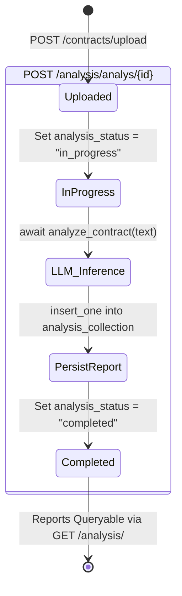

# 🧠 Deep-Dive Guide: `app/routes/analysis_routes.py` (Vakil-Contract-Vision)

> **File:** [`app/routes/analysis_routes.py`](file:///c:/Users/ADMIN/Documents/hemant-python/Vakil-Contract-Vision/app/routes/analysis_routes.py)  
> **Role in Architecture:** Legal AI Orchestration & Analysis Reporting Router. Manages the contract lifecycle state machine (`uploaded` &rarr; `in_progress` &rarr; `completed`), triggers Google Gemini legal inference, persists structured audit reports in MongoDB, and executes BSON `ObjectId` serialization across all retrieval queries.

---

## 🧭 Navigation
- ⬅️ **Previous File:** [`docs/08_file_guide_contracts_routes_py.md`](08_file_guide_contracts_routes_py.md) &mdash; Contract Upload & File Ingestion Endpoints
- ➡️ **Next File:** [`docs/10_file_guide_main_py.md`](10_file_guide_main_py.md) &mdash; FastAPI Application Gateway & Startup Events

---

## 🎯 1. Why We Use It

Once a contract is uploaded and parsed, the system must coordinate its artificial intelligence audit:
1. **Precondition Validation:** Confirm the Google API key is configured, the contract document exists in the database, and extracted text content is present.
2. **State Machine Management:** Contract analysis is an asynchronous operation. The system must update the contract's status to `in_progress` to notify frontend clients that AI processing is underway, and then transition to `completed` upon success.
3. **Report Persistence:** Store the structured AI legal audit (key clauses, risk flags, recommendations, overall risk score) in MongoDB's `analysis` collection, linked via `contract_id`.
4. **BSON Serialization:** Bridge MongoDB's internal binary `ObjectId` format with standard JSON responses expected by web clients and frontend frameworks.

[`app/routes/analysis_routes.py`](file:///c:/Users/ADMIN/Documents/hemant-python/Vakil-Contract-Vision/app/routes/analysis_routes.py) handles all four responsibilities across four distinct endpoints.



---

## 🔍 2. Full Code & Line-by-Line Deep Dive

Here is the exact code of [`app/routes/analysis_routes.py`](file:///c:/Users/ADMIN/Documents/hemant-python/Vakil-Contract-Vision/app/routes/analysis_routes.py):

```python
from fastapi import APIRouter,  File, UploadFile, HTTPException
from config import GOOGLE_API_KEY
from models import Contract
from database import contracts_collection
from bson import ObjectId
from service.gemini_analyze import analyze_contract
from database import analysis_collection


router = APIRouter(
    prefix="/analysis",
    tags=["analysis"]
)

@router.post("/analys/{contract_id}")
async def analyse_contract(contract_id: str):
    """
    Analyze a contract using AI and return insights.
    """

    if not GOOGLE_API_KEY:
        raise HTTPException(status_code=500, detail="AI API key is not configured")

    contract = contracts_collection.find_one({"_id": ObjectId(contract_id)})

    if not contract:
        raise HTTPException(status_code=404, detail="Contract not found")

    if not contract.get("text_content"):
        raise HTTPException(status_code=400, detail="Contract has no text content to analyze")

    contracts_collection.update_one({"_id": ObjectId(contract_id)}, {"$set": {"analysis_status": "in_progress"}})

    result = await analyze_contract(contract_id, contract["text_content"])

    doc = result.model_dump()
    insert_result = analysis_collection.insert_one(doc)
    result.id = str(insert_result.inserted_id)

    contracts_collection.update_one({"_id": ObjectId(contract_id)}, {"$set": {"analysis_status": "completed"}})

    return {
        "message": "Contract analyzed successfully",
        "analysis": result.model_dump(),
        "id": result.id
    }


@router.get("/{analysis_id}")
async def get_analysis(analysis_id: str):
    """
    Retrieve the results of a specific analysis by ID.
    """
    analysis = analysis_collection.find_one({"_id": ObjectId(analysis_id)})

    if not analysis:
        raise HTTPException(status_code=404, detail="Analysis not found")

    analysis["id"] = str(analysis.pop("_id")) 
    return {"analysis": analysis}


@router.get('/')
def list_analyses():
    """
    List all analyses performed.
    """
    def _convert_obj(obj):
        # recursively convert ObjectId to str for JSON serialization
        if isinstance(obj, list):
            return [_convert_obj(v) for v in obj]
        if isinstance(obj, dict):
            new = {}
            for k, v in obj.items():
                if k == '_id':
                    new['id'] = str(v)
                else:
                    new[k] = _convert_obj(v)
            return new
        try:
            from bson import ObjectId
            if isinstance(obj, ObjectId):
                return str(obj)
        except Exception:
            pass
        return obj

    analyses = [_convert_obj(doc) for doc in analysis_collection.find({})]
    return {"analyses": analyses}


@router.get("/contract/{contract_id}")
async def get_analyses_for_contract(contract_id: str):
    """Get all analyses for a specific contract."""
    analyses = []
    cursor = analysis_collection.find({"contract_id": contract_id})

    for doc in cursor:
        doc["id"] = str(doc.pop("_id"))
        analyses.append(doc)

    return {"analyses": analyses, "total": len(analyses)}
```

---

### Detailed Breakdown

#### Lines 10–13: Router Registration
* `prefix="/analysis"`: Groups endpoints under `/analysis`.
* `tags=["analysis"]`: Generates a dedicated Swagger UI section.

---

### Endpoint 1: `POST /analysis/analys/{contract_id}` (Lines 15–46)

#### 1. Three Strict Guard Clauses (Lines 21–30)
* **Guard 1 (API Key Check):**
  ```python
  if not GOOGLE_API_KEY:
      raise HTTPException(status_code=500, detail="AI API key is not configured")
  ```
  Prevents unhandled runtime crashes if the `.env` file is missing or invalid.
* **Guard 2 (Contract Existence):**
  Queries MongoDB using `ObjectId(contract_id)`. If the ID does not exist, returns `HTTP 404 Not Found`.
* **Guard 3 (Content Validation):**
  Verifies that `text_content` contains text. If the user uploaded an empty document or scanned PDF with no text layer, halts immediately with `HTTP 400 Bad Request`.

#### 2. State Transition 1: Mark as In-Progress (Line 32)
```python
contracts_collection.update_one(
    {"_id": ObjectId(contract_id)},
    {"$set": {"analysis_status": "in_progress"}}
)
```
* Uses MongoDB's atomic `$set` operator to update the contract state to `"in_progress"`.
* If a frontend dashboard is polling the contract, it can now render a loading spinner: *"Vakil AI is analyzing your clauses..."*.

#### 3. AI Execution & Persistence (Lines 34–38)
```python
result = await analyze_contract(contract_id, contract["text_content"])

doc = result.model_dump()
insert_result = analysis_collection.insert_one(doc)
result.id = str(insert_result.inserted_id)
```
* Awaits `analyze_contract()` in [`gemini_analyze.py`](file:///c:/Users/ADMIN/Documents/hemant-python/Vakil-Contract-Vision/app/service/gemini_analyze.py).
* Dumps the validated Pydantic model into a dictionary and inserts into `analysis_collection`.
* Assigns the new MongoDB primary key string to `result.id`.

#### 4. State Transition 2: Mark as Completed (Line 40)
```python
contracts_collection.update_one(
    {"_id": ObjectId(contract_id)},
    {"$set": {"analysis_status": "completed"}}
)
```
* Finalizes the state machine transition to `"completed"`.

---

### Endpoint 2: `GET /analysis/{analysis_id}` (Lines 49–60)

#### The BSON `ObjectId` Serialization Fix (Line 59)
```python
analysis["id"] = str(analysis.pop("_id"))
return {"analysis": analysis}
```
* **Why this line is critical:**
  * Raw PyMongo documents contain `_id: ObjectId("6746...")`.
  * Standard Python `json.dumps()` and FastAPI's `jsonable_encoder` do **not** recognize BSON `ObjectId` objects and crash with:
    `ValueError: ['ObjectId' is not iterable]`
  * Calling `.pop("_id")` deletes the raw BSON object and reassigns its string representation to `"id"`, guaranteeing clean JSON serialization!

---

### Endpoint 3: `GET /analysis/` (Lines 63–89)

#### The Recursive Serialization Engine (`_convert_obj`)
* When listing all analysis reports across the entire database, reports contain nested sub-documents (e.g., clauses, risk flags).
* The helper function `_convert_obj` uses recursion to traverse nested lists and dictionaries:
  ```python
  def _convert_obj(obj):
      if isinstance(obj, list):
          return [_convert_obj(v) for v in obj]
      if isinstance(obj, dict):
          new = {}
          for k, v in obj.items():
              if k == '_id':
                  new['id'] = str(v)
              else:
                  new[k] = _convert_obj(v)
          return new
      if isinstance(obj, ObjectId):
          return str(obj)
      return obj
  ```
  This guarantees that **zero** BSON `ObjectId` instances survive to cause serialization crashes, no matter how deeply nested the document is.

---

### Endpoint 4: `GET /analysis/contract/{contract_id}` (Lines 92–102)

#### Foreign-Key Relational Lookups in MongoDB
* A single contract might be analyzed multiple times (e.g., after contract renegotiation or with updated prompt rules).
* `analysis_collection.find({"contract_id": contract_id})` acts as a relational **Foreign Key query**, returning all historical audit versions associated with that parent contract ID.

---

## ⚡ 3. The Classic Production Bug We Diagnosed

### The `ObjectId is not iterable` Crash
* **What Happened:**
  When testing `GET /analysis/{id}`, FastAPI threw:
  ```text
  ValueError: [TypeError("'ObjectId' object is not iterable")]
  ```
* **The Root Cause:**
  The original code returned `return {"analysis": analysis}` directly after PyMongo fetched the document. Because `analysis["_id"]` was a 12-byte binary BSON `ObjectId` instance, Starlette's response encoder crashed.
* **The Resolution:**
  We replaced `_id` with a sanitized string `id`:
  ```python
  analysis["id"] = str(analysis.pop("_id"))
  ```

---

## ⚖️ 4. Synchronous vs Background Job Architecture

| Architecture Pattern | User Wait Time | Implementation Complexity | Best Suited For |
| :--- | :--- | :--- | :--- |
| **Direct Request-Response (`await`)** (Current) | 2–4 seconds | ⭐ Minimal (Single async route) | Short-to-medium contracts (under 15 pages) |
| **FastAPI `BackgroundTasks`** | Instant (202 Accepted) | ⭐⭐ Low (Built into FastAPI) | Background processing without external queues |
| **Distributed Queue (Celery + Redis)** | Instant (202 Accepted) | ⭐⭐⭐⭐ Enterprise (Redis + Workers) | 100+ page contracts, OCR pipelines, high-volume SaaS |

---

## 🧠 5. How to Permanently Remember It (Mental Analogies)

### Analogy 1: The Hospital Pathology Lab Diagnosis
* **Phase 1 (`uploaded`):** The patient gives a blood sample at the clinic.
* **Phase 2 (`in_progress`):** The test tube is sent to the pathology lab. The technician updates the hospital portal status to *"Testing in progress"*.
* **Phase 3 (Gemini Analysis):** The pathologist examines the blood under the microscope for antibodies and legal risks.
* **Phase 4 (`completed`):** The test results are entered into the electronic health record, the status flips to *"Report Ready"*, and the patient downloads the report.

### Analogy 2: The Currency Exchange Booth (`_convert_obj`)
* MongoDB uses **foreign currency (BSON `ObjectId`)**.
* Your web browser only accepts **domestic currency (JSON Strings)**.
* When you leave MongoDB with a wallet full of BSON bills, the border exchange teller (`_convert_obj`) converts every foreign bill into standard legal tender (`str(obj)`) so you can spend it in the browser!

---

## 💼 6. Senior Technical Interview Battle Cards

### Q1: Why does returning a raw PyMongo dictionary in FastAPI cause a serialization error, and how do you resolve it?
> **Answer:**  
> PyMongo documents contain a default `_id` field of type `bson.objectid.ObjectId`. Standard JSON serializers (including FastAPI's `jsonable_encoder`) do not recognize BSON `ObjectId` types and throw a `TypeError: 'ObjectId' object is not iterable`.  
> There are three standard solutions:  
> 1. Manually pop and cast: `doc["id"] = str(doc.pop("_id"))`.  
> 2. Use a recursive sanitizer function (`_convert_obj`) that replaces any `ObjectId` with a string.  
> 3. Use Pydantic with custom field serializers or validators (such as `BeforeValidator(str)` or PyObjectId).

### Q2: Why is implementing an explicit state machine (`analysis_status: "in_progress"` &rarr; `"completed"`) vital in AI APIs?
> **Answer:**  
> Generative AI inference operations introduce network latency (typically 2 to 10 seconds). In modern web applications, the frontend relies on status fields to render asynchronous UI states (spinners, progress bars, or disabled buttons). If a user attempts to view reports while inference is running, checking `analysis_status == "in_progress"` allows the frontend to poll gracefully rather than showing a premature "No analysis found" error.

### Q3: What happens if Gemini raises an unhandled exception during `analyze_contract()`? How does that impact the contract's state?
> **Answer:**  
> In the current implementation, if `analyze_contract()` crashes (e.g., due to an API quota exhaustion or network timeout), execution terminates before reaching line 40 (`analysis_status = "completed"`). Consequently, the contract remains permanently stuck in `"in_progress"`.  
> In production, this should be wrapped in a `try...except` block:
> ```python
> try:
>     result = await analyze_contract(...)
>     contracts_collection.update_one({"_id": oid}, {"$set": {"analysis_status": "completed"}})
> except Exception as e:
>     contracts_collection.update_one({"_id": oid}, {"$set": {"analysis_status": "failed", "error": str(e)}})
>     raise HTTPException(status_code=500, detail="AI analysis failed")
> ```

### Q4: How does `GET /analysis/contract/{contract_id}` maintain relational integrity in a NoSQL database?
> **Answer:**  
> Although MongoDB is a NoSQL document database without foreign key constraints, relational associations are modeled by embedding reference identifiers. In our schema, every document in `analysis_collection` stores a `contract_id: str` attribute referencing the `_id` of the parent contract in `contracts_collection`. Querying `{"contract_id": contract_id}` acts as an indexed child lookup, enabling 1-to-many relationships (one contract having multiple historical audit reports).

---

## 🔗 Next Step
Proceed to **File 10**: [`docs/10_file_guide_main_py.md`](10_file_guide_main_py.md) to explore the central FastAPI application gateway, startup lifespan events, and router registration.
