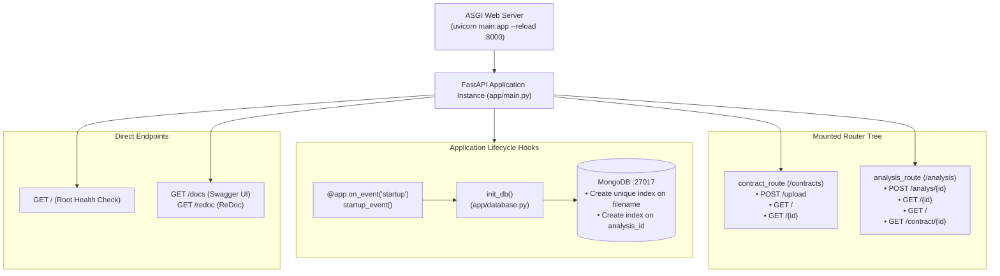

# 🚀 Deep-Dive Guide: `app/main.py` (Vakil-Contract-Vision)

> **File:** [`app/main.py`](file:///c:/Users/ADMIN/Documents/hemant-python/Vakil-Contract-Vision/app/main.py)  
> **Role in Architecture:** Central ASGI Application Gateway, Assembly Root & Lifespan Controller. Instantiates the FastAPI application, exposes automated OpenAPI / Swagger documentation, coordinates startup database index provisioning (`init_db`), mounts modular API routers, and provides the root health check.

---

## 🧭 Navigation
- ⬅️ **Previous File:** [`docs/09_file_guide_analysis_routes_py.md`](09_file_guide_analysis_routes_py.md) &mdash; AI Analysis Orchestration & Reporting
- 🏠 **Master Overview:** [`README.md`](../README.md) &mdash; Project Purpose, Architecture & Execution Protocol

---

## 🎯 1. Why We Use It

A production-grade Python backend needs a single, unambiguous **entry point**:
1. **ASGI Application Instantiation:** ASGI web servers like **Uvicorn** require a callable application instance (`main:app`) to bind TCP sockets and dispatch asynchronous HTTP requests.
2. **Modular Architecture Assembly:** Instead of writing hundreds of endpoints inside a single monolithic file, our endpoints are decoupled into feature routers (`contracts_routes.py` and `analysis_routes.py`). `main.py` acts as the central switchboard mounting these sub-routers.
3. **Application Lifecycle Hooks:** The database cannot create indexes until the application boots. `main.py` manages startup hooks to verify database health and provision B-tree indexes before any client requests are accepted.
4. **Interactive Documentation Gateway:** Registers metadata (`title`, `description`, `version`) to automatically generate OpenAPI 3.0 specifications and interactive **Swagger UI** (`/docs`) and **ReDoc** (`/redoc`) explorers.



---

## 🔍 2. Full Code & Line-by-Line Deep Dive

Here is the exact code of [`app/main.py`](file:///c:/Users/ADMIN/Documents/hemant-python/Vakil-Contract-Vision/app/main.py):

```python
from fastapi import FastAPI
from database import init_db
from routes.contracts_routes import router as contract_route
from routes.analysis_routes import router as analysis_route

app = FastAPI(
    title="Vakil Contracts API",
    description="AI-Powered Contract Analysis using Gemini",
    version="1.0.0"
)

@app.on_event("startup")
async def startup_event():
    init_db()

app.include_router(contract_route)
app.include_router(analysis_route)

@app.get("/")
async def root():
    return {
        "message": "Vakil Contrats API is running."
    }
```

---

### Detailed Breakdown

#### Lines 1–4: Imports & Router Aliasing
```python
from fastapi import FastAPI
from database import init_db
from routes.contracts_routes import router as contract_route
from routes.analysis_routes import router as analysis_route
```
* **`FastAPI`:** The high-performance modern web framework built on top of **Starlette** (for asynchronous networking) and **Pydantic** (for data validation).
* **`init_db`:** Imported from [`app/database.py`](file:///c:/Users/ADMIN/Documents/hemant-python/Vakil-Contract-Vision/app/database.py).
* **Router Aliasing (`as contract_route`, `as analysis_route`):** Both route files export an object named `router`. Python does not allow duplicate variable names in the same namespace; aliasing them prevents variable shadowing and makes code self-documenting.

#### Lines 6–10: FastAPI Application Instantiation & OpenAPI Metadata
```python
app = FastAPI(
    title="Vakil Contracts API",
    description="AI-Powered Contract Analysis using Gemini",
    version="1.0.0"
)
```
* Instantiates the core ASGI application object `app`.
* **Swagger Customization:**
  * `title`: Renders as the primary header on `http://127.0.0.1:8000/docs`.
  * `description`: Explains backend capabilities to frontend developers and API consumers.
  * `version`: Version tracking for client SDK generation.

#### Lines 12–14: Startup Lifespan Hook (`@app.on_event("startup")`)
```python
@app.on_event("startup")
async def startup_event():
    init_db()
```
* **Why this is critical:**
  * Executing database setup code at the top level of a Python file (during module import) is an antipattern. It freezes unit test suites, slows down CLI tools, and can fail if the database container is still booting.
  * Registering `init_db()` inside `startup_event` guarantees that it runs **only after Uvicorn has initialized the Python `asyncio` event loop**.
  * **Instant Health Check:** If MongoDB is down or the URI credentials are wrong, `init_db()` crashes immediately on boot with a clear error trace, preventing the application from accepting client traffic in a broken state.

#### Lines 16–17: Mounting Feature Routers (`app.include_router`)
```python
app.include_router(contract_route)
app.include_router(analysis_route)
```
* Mounts all endpoints declared in `contracts_routes.py` and `analysis_routes.py` onto the primary application tree.
* Because `contract_route` defines `prefix="/contracts"` and `analysis_route` defines `prefix="/analysis"`, FastAPI automatically registers:
  * `/contracts/upload`
  * `/contracts/`
  * `/contracts/{contract_id}`
  * `/analysis/analys/{contract_id}`
  * `/analysis/{analysis_id}`
  * `/analysis/`
  * `/analysis/contract/{contract_id}`

#### Lines 19–23: Root Health Check Endpoint
```python
@app.get("/")
async def root():
    return {
        "message": "Vakil Contrats API is running."
    }
```
* Serves as a lightweight, zero-cost health check endpoint (`GET /`).
* In production cloud environments (AWS ECS, Kubernetes, Google Cloud Run), load balancers ping `GET /` every 10 seconds to verify that the container is healthy and ready to receive traffic.

---

## ⚡ 3. The Two Startup Pitfalls We Solved

### Pitfall A: `Error loading ASGI app. Could not import module "main"`
* **What Happened:**
  Running `uvicorn main:app --reload` from `Vakil-Contract-Vision/` produced:
  ```text
  ERROR: Error loading ASGI app. Could not import module "main".
  ```
* **The Root Cause:**
  * Uvicorn was invoked in the project root directory (`Vakil-Contract-Vision/`).
  * Python searches for modules in `sys.path` (starting with the current working directory).
  * `main.py` was located inside `Vakil-Contract-Vision/app/`, not in the root directory!
* **The Resolution:**
  Either navigate into `app` first:
  ```powershell
  cd C:\Users\ADMIN\Documents\hemant-python\Vakil-Contract-Vision\app
  uvicorn main:app --reload
  ```
  Or tell Uvicorn the module path or app directory:
  ```powershell
  uvicorn app.main:app --reload
  ```

---

### Pitfall B: Crash on `init_db()` during Startup
* **What Happened:**
  When `app/.env` had `mongodb:27017` instead of `localhost:27017`, Uvicorn crashed during startup:
  ```text
  INFO: Started server process [25904]
  INFO: Waiting for application startup.
  ERROR: Traceback ... in startup_event: init_db()
  pymongo.errors.ServerSelectionTimeoutError: mongodb:27017: [Errno 11001] getaddrinfo failed
  ERROR: Application startup failed. Exiting.
  ```
* **The Takeaway:**
  Notice Uvicorn’s log: `Application startup failed. Exiting.`
  Because `init_db()` is hooked to `@app.on_event("startup")`, FastAPI refuses to serve traffic when the database is unreachable, protecting clients from silent data corruption.

---

## ⚖️ 4. Modern Lifespan Evolution in FastAPI

In FastAPI versions `>= 0.93.0`, `@app.on_event("startup")` and `@app.on_event("shutdown")` are being superseded by the standard **Lifespan Context Manager** pattern (`lifespan`).

### How to Write a Modern Lifespan Handler:
```python
from contextlib import asynccontextmanager
from fastapi import FastAPI
from database import init_db

@asynccontextmanager
async def lifespan(app: FastAPI):
    # --- STARTUP PHASE ---
    print("🚀 Application starting: Provisioning MongoDB indexes...")
    init_db()
    
    yield  # Application runs and handles HTTP requests here!
    
    # --- SHUTDOWN PHASE ---
    print("🛑 Application shutting down: Closing connection pools...")
    # client.close()

app = FastAPI(
    title="Vakil Contracts API",
    lifespan=lifespan
)
```
* **Why Lifespan is superior:**
  1. Unifies startup and shutdown logic into a single Python generator function.
  2. Uses standard Python context manager semantics (`async with`).
  3. Ensures proper cleanup and connection pool draining when containers are terminated by `SIGTERM`.

---

## 🧠 5. How to Permanently Remember It (Mental Analogies)

### Analogy 1: The Grand Central Railway Concourse
* `main.py` is the **Grand Central Railway Station Concourse**.
* The concourse doesn't build trains or manufacture steel tracks; it connects passenger entrances (`GET /docs`, `GET /`) to the regional railway lines:
  - Track 1: Regional Contract Ingestion Line (`contract_route`).
  - Track 2: High-Speed AI Legal Analysis Express (`analysis_route`).
* Before the stationmaster unlocks the front gates in the morning, they run a safety sweep across all rail switches (`startup_event` &rarr; `init_db`).

### Analogy 2: The Computer Motherboard
* `main.py` is the **PC Motherboard**.
* You don't solder GPUs and sound cards directly into the CPU; you plug them into standard PCIe slots (`include_router`).
* When you press the power button, the motherboard runs the BIOS Power-On Self-Test (POST) (`startup_event`). If the RAM or database fails POST, the motherboard beeps and halts boot immediately.

---

## 💼 6. Senior Technical Interview Battle Cards

### Q1: What is the architectural difference between WSGI and ASGI, and why does FastAPI use ASGI?
> **Answer:**  
> **WSGI (Web Server Gateway Interface)**, used by Flask and legacy Django, is synchronous. A WSGI worker thread blocks while waiting for I/O operations (such as waiting 3 seconds for Google Gemini to return legal analysis). Under high traffic, worker threads quickly exhaust, causing latency spikes.  
> **ASGI (Asynchronous Server Gateway Interface)**, used by FastAPI and Starlette, natively supports Python's `asyncio` event loop. When a route performs an `await` on an external LLM API or async database call, the worker thread immediately handles other incoming HTTP connections, enabling massive concurrent throughput with minimal memory footprint.

### Q2: Why is `@app.on_event("startup")` being replaced by `lifespan` in modern FastAPI?
> **Answer:**  
> `@app.on_event` had fragmented startup and shutdown definitions, making it difficult to share state (like database connection handles or ML model weights) across the startup and shutdown boundaries. The `lifespan` context manager, defined using `@asynccontextmanager`, unifies both phases into a single generator using standard Python context management. It allows clean dependency injection and ensures graceful shutdown handlers run reliably when container orchestrators send `SIGTERM`.

### Q3: Why does `sys.path` matter when running `uvicorn main:app --reload`?
> **Answer:**  
> Uvicorn dynamically imports the application module specified in its CLI string. Python looks for `main.py` within directories listed in `sys.path`, which defaults to the Current Working Directory (`os.getcwd()`). If Uvicorn is executed from the parent project directory (`Vakil-Contract-Vision/`) while `main.py` is inside `app/`, Python fails with `Could not import module "main"`. You must either `cd` into the subfolder or specify the module path with dot notation (`uvicorn app.main:app --reload`).

### Q4: How would you enable Cross-Origin Resource Sharing (CORS) in `main.py` for a React or Vue frontend?
> **Answer:**  
> You attach Starlette's `CORSMiddleware`:
> ```python
> from fastapi.middleware.cors import CORSMiddleware
> 
> app.add_middleware(
>     CORSMiddleware,
>     allow_origins=["http://localhost:3000", "https://vakil-vision.com"],
>     allow_credentials=True,
>     allow_methods=["*"],
>     allow_headers=["*"],
> )
> ```
> This configures the `Access-Control-Allow-Origin` HTTP response headers, permitting the browser frontend to execute cross-origin requests to the FastAPI backend.

---

## 🏆 Project Architecture Complete!
All 10 project files have now been fully analyzed, documented, and linked. Refer back to the master [`README.md`](../README.md) for full architecture flows and execution guides.
