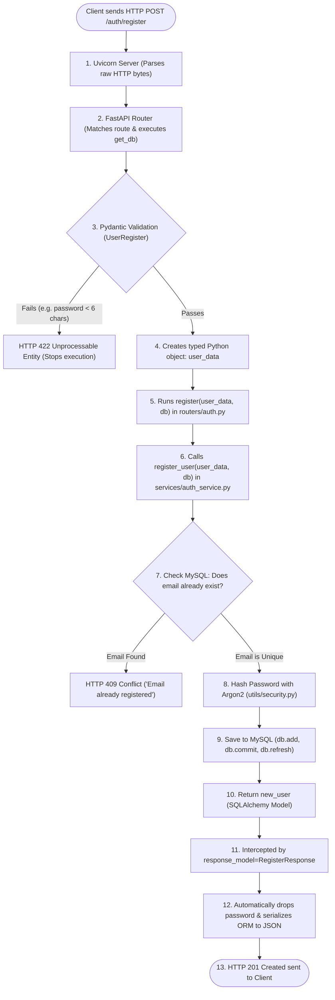
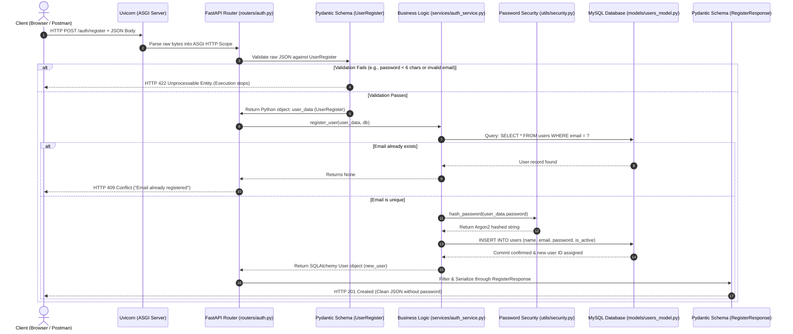

# FastAPI Request Lifecycle: User Registration Flow

This document details the end-to-end journey of an HTTP request through the `authentication_demo` application when a client registers a new user via `POST /auth/register`.

---

## 1. Visual Flowchart Diagram



---

## 2. Detailed Sequence Diagram



---

## 3. Step-by-Step Breakdown

### Step 1: Client Sends Raw HTTP Request

The client (Postman, browser frontend, mobile app) transmits an HTTP POST request over TCP port 8000:

```http
POST /auth/register HTTP/1.1
Host: 127.0.0.1:8000
Content-Type: application/json

{
  "name": "John Doe",
  "email": "john@testmail.com",
  "password": "mypassword123"
}
```

---

### Step 2: Uvicorn ASGI Server Receives Raw Data

1. **Uvicorn** is the asynchronous server (ASGI) listening on `127.0.0.1:8000`.
2. It receives raw byte streams over the TCP socket, reads HTTP headers, and structures the incoming request into standard ASGI dictionaries.
3. It hands this request over to the **FastAPI** application instance defined in `main.py`.

---

### Step 3: FastAPI Matches the Route and Dependency Injection

FastAPI checks registered endpoints in `main.app`:

1. It matches the path `/auth/register` and HTTP method `POST` to the route function in `routers/auth.py`:
   ```python
   @router.post("/register", response_model=RegisterResponse, status_code=status.HTTP_201_CREATED)
   def register(user_data: UserRegister, db: Session = Depends(get_db)):
   ```
2. **Dependency Injection**: FastAPI evaluates `db: Session = Depends(get_db)`.
   - It executes `get_db()` from `database.py`.
   - A new database session `db` is created from `LocalSession()` and yielded into the route function.

---

### Step 4: Pydantic Input Validation (`UserRegister`)

FastAPI reads the JSON request body and automatically feeds it into the `UserRegister` Pydantic class:

```python
user_data = UserRegister(
    name="John Doe",
    email="john@testmail.com",
    password="mypassword123"
)
```

Pydantic validates each field:

- **`name`**: Checked against `min_length=2` and `max_length=100`.
- **`email`**: Validated by `EmailStr` (verifies syntax according to RFC email standards).
- **`password`**: Checked against `min_length=6` and `max_length=150`.

#### What Happens if Validation Fails?

If the user sends `"password": "12345"` (only 5 characters) or an invalid email:

- Pydantic raises a `ValidationError`.
- **Your function code never runs**. Execution halts immediately.
- FastAPI returns an automatic `HTTP 422 Unprocessable Entity` response with the exact field error details.

#### What Happens When Validation Passes?

- Pydantic creates a validated Python object: `<class 'schemas.user_schema.UserRegister'>`.
- FastAPI delivers this object directly as the `user_data` argument in `register(user_data, db)`.

---

### Step 5: Inside the Router Function (`routers/auth.py`)

In Python code, you access the validated input using **object attribute dot notation**:

```python
@router.post("/register", response_model=RegisterResponse, status_code=status.HTTP_201_CREATED)
def register(user_data: UserRegister, db: Session = Depends(get_db)):
    # user_data is a strongly-typed Python object:
    print(user_data.name)      # -> "John Doe"
    print(user_data.email)     # -> "john@testmail.com"
    print(user_data.password)  # -> "mypassword123"

    # Forward data to the service layer:
    new_user = register_user(user_data, db)
```

---

### Step 6: Service Layer & Business Logic (`services/auth_service.py`)

The service layer handles database queries and cryptography:

1. **Duplicate Email Check**:

   ```python
   user_exist = db.query(User).filter(User.email == user_data.email).first()
   if user_exist:
       return None  # Triggers HTTP 409 in the router
   ```

2. **Password Hashing**:

   ```python
   hashed_password = hash_password(user_data.password)
   ```

   - Plain text password `"mypassword123"` is hashed using `pwdlib` (Argon2).
   - Result: A secure string like `$argon2id$v=19$m=65536,t=3,p=4$...`.
   - The plain password is never saved in the database.

3. **Database Persistence**:
   ```python
   new_user = User(
       name=user_data.name,
       email=user_data.email,
       password=hashed_password
   )
   db.add(new_user)
   db.commit()
   db.refresh(new_user)  # Loads auto-generated database ID
   ```

---

### Step 7: Response Serialization & Security Filtering (`RegisterResponse`)

The router returns a dictionary containing the newly created user:

```python
return {
    "message": "User registered successfully",
    "user": new_user
}
```

FastAPI intercepts this return value before sending it over the network because `response_model=RegisterResponse` is configured:

```
Database Object (new_user):
  - id = 1
  - name = "John Doe"
  - email = "john@testmail.com"
  - password = "$argon2id$..."   <--- (Sensitive hash)
  - is_active = True

               ⬇️ Filtered by RegisterResponse & UserResponse

Client JSON Output:
{
  "message": "User registered successfully",
  "user": {
    "id": 1,
    "name": "John Doe",
    "email": "john@testmail.com",
    "is_active": true
  }
}
```

1. **Security Filtering**: `UserResponse` does not declare a `password` field. FastAPI strips the hashed password out completely.
2. **ORM Attribute Translation**: `model_config = ConfigDict(from_attributes=True)` enables FastAPI to read attributes directly from the SQLAlchemy model (`new_user.id`, `new_user.name`, etc.).
3. **HTTP 201 Status**: The client receives standard `HTTP 201 Created`.
4. **Session Cleanup**: In `database.py`, the `get_db` generator reaches its `finally: db.close()` block, closing the database connection and returning it to the connection pool.

---

## 4. Quick Reference: File Responsibilities

| File                       | Role in the Request Lifecycle                                                            |
| :------------------------- | :--------------------------------------------------------------------------------------- |
| `main.py`                  | App entry point; mounts routes and manages server lifespan.                              |
| `routers/auth.py`          | Receives HTTP request, handles dependencies, invokes service, returns HTTP status codes. |
| `schemas/user_schema.py`   | Validates incoming JSON (`UserRegister`) and formats outgoing JSON (`RegisterResponse`). |
| `services/auth_service.py` | Coordinates business logic (checks duplicates, hashes password, commits transaction).    |
| `utils/security.py`        | Encrypts password using modern Argon2 algorithms.                                        |
| `models/users_model.py`    | SQLAlchemy ORM model defining the `users` table structure in MySQL.                      |
| `database.py`              | Supplies database sessions and cleans up connections after each request.                 |
